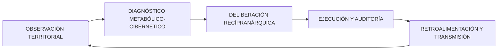

# Prospectiva Metabolicocibernética Recípranárquica Transgeneracional (PMCRT)
## Operacionalización para Zeitnus/ALRAC/HSCSG

**Versión:** 1.0.0 | **Fecha:** 2026-10-20 | **RAO:** `RAO:pmcrt:20261020:001`
**Estado:** Spec viva — sujeta a revisión asamblearia y validación en piloto

---

## 1. DEFINICIÓN OPERACIONAL

La **Prospectiva Metabolicocibernética Recípranárquica Transgeneracional (PMCRT)** es el método por el cual una red de comunidades autónomas observa, coordina y regenera las condiciones materiales, sanitarias, cognitivas y organizativas que sostienen la vida.

Combina cinco componentes integrados:

| Componente | Función | Traducción operativa |
|------------|---------|---------------------|
| **Prospectiva** | Anticipar sin pretender adivinar | Construir escenarios, detectar señales tempranas, identificar decisiones reversibles/irreversibles |
| **Metabólica** | Contabilizar flujos que sostienen la vida | Balance de materiales/energía (entradas, stocks, salidas, residuos, regeneración) en unidades físicas |
| **Cibernética** | Detectar desviaciones y corregirlas | Observar estado → comparar con límites/objetivos → modificar comportamiento → volver a medir (Ley de Ashby) |
| **Recípranárquica** | Reciprocidad sin autoridad central permanente | Subsidiariedad, federación voluntaria, una persona/un voto, reglas de Ostrom para bienes comunes |
| **Transgeneracional** | Actuar sin hipotecar el futuro | Evaluar efectos en 7 generaciones, preservar capacidad regenerativa, transmitir conocimiento útil |

**Principio rector:** Una comunidad no es autónoma por acumular recursos, sino por poder sostenerlos, regenerarlos, compartirlos y corregir sus desequilibrios sin perder la libertad de sus integrantes ni destruir las condiciones de vida de quienes vendrán después.

---

## 2. ARQUITECTURA DEL ESTADO TERRITORIAL

Cada nodo mantiene un vector de estado observable:

```
x_t = (W, F, E, H, C, M, B, G, L)
```

| Variable | Significado operativo | Unidad | Fuente de datos |
|----------|----------------------|--------|-----------------|
| **W** | Disponibilidad, calidad y seguridad del agua | m³, mg/L, Índice calidad | Sensores IoT, análisis laboratorio, medición comunitaria |
| **F** | Disponibilidad y suficiencia alimentaria | kcal/día/hab, kg/año, Índice diversidad | Cosechas, inventarios, encuestas nutricionales |
| **E** | Balance de energía útil neta | kWh/día, kWh/año | Medidores, facturas, producción renovable |
| **H** | Capacidad de mantener viviendas/hábitats | m²/hab, Índice estado, % reparaciones pendientes | Inspecciones técnicas, censos habitacionales |
| **C** | Capacidad de cuidado y estado de salud | % cobertura preventiva, años vida saludable, hospitalizaciones evitables | Registros sanitarios, encuestas funcionales |
| **M** | Memoria, conocimientos, capacidades transmisibles | % docs con consentimiento, procesos reproducibles, habilidades documentadas | Archivo vivo, auditorías de restauración |
| **B** | Estado del suelo, biodiversidad, regeneración | % carbono orgánico, Índice biodiversidad, tasa erosión | Análisis suelo, bioindicaores, teledetección |
| **G** | Gobernanza, autonomía, confianza, conflictos | Índice participación, concentración poder, conflictos resueltos | Auditoría asambleas, métricas CDS/ICS |
| **L** | Liquidez, reservas, recursos financieros | Fiat (USD/MXN), ZNU, TQ, tiempo | Contabilidad fiat, ledger TQ, ValueFlows |

**Dinámica:** `x_{t+1} = f(x_t, u_t, w_t)`
- `u_t`: decisiones y asignaciones de recursos (control)
- `w_t`: perturbaciones (sequía, epidemia, conflicto, shock externo)
- `f`: función de transición — **por especificar y calibrar en piloto**

---

## 3. CICLO OPERATIVO PMCRT (5 Fases)



### Fase 1: OBSERVACIÓN TERRITORIAL
**Entradas:** Agua · Alimentos · Energía · Vivienda · Salud · Suelo · Memoria · Recursos disponibles
**Salida:** Línea de base territorial actualizada (vector x_t)
**Herramientas:** Sensores, encuestas, censos, inventarios, análisis de laboratorio, archivo vivo

### Fase 2: DIAGNÓSTICO METABÓLICO-CIBERNÉTICO
**Entradas:** Stocks, flujos, necesidades no cubiertas, riesgos, capacidades de regeneración, desigualdades
**Procesamiento:**
- Balance metabólico por recurso (entradas = salidas + residuos + emisiones + Δstocks + diferencia no explicada)
- Detección de desviaciones vs límites planetarios/locales
- Identificación de dependencias críticas y vulnerabilidades
- Análisis de variedad requerida (Ashby): ¿capacidad de respuesta ≥ variedad de perturbaciones?
**Salida:** Informe de diagnóstico con alertas, prioridades y opciones

### Fase 3: DELIBERACIÓN RECÍPRANÁRQUICA
**Entradas:** Propuestas locales, reglas de subsidiariedad, participación, consentimiento, evaluación intergeneracional
**Mecanismo:**
- Propuestas surgen en nodo local (autonomía)
- Coordinación federada solo donde mejore resiliencia sin concentrar poder
- Una persona, un voto (ALRAC) — no ponderación por tokens/aportaciones
- Consejo de Futuros: veto suspensivo con plazo, justificación pública, apelación
**Salida:** Asignaciones a tres fondos + plan de ejecución

### Fase 4: EJECUCIÓN Y AUDITORÍA
**Entradas:** Desembolso, responsable, hitos, evidencia, costes reales, registro verificable
**Controles:**
- Balances independientes por unidad (fiat, TQ, especie, tiempo)
- Trazabilidad RAO por asignación
- Auditoría termodinámica post-ejecución (kWh medidos)
- Separación: datos personales off-ledger, solo hashes en RAO
**Salida:** Registro auditado de ejecución

### Fase 5: RETROALIMENTACIÓN Y TRANSMISIÓN
**Entradas:** Resultados vs objetivos, corrección de políticas, memoria de aprendizajes, revisión de escenarios
**Salida:** Línea de base actualizada (x_{t+1}), escenarios revisados, lecciones documentadas

---

## 4. LOS TRES FONDOS COMO SUBSISTEMAS METABÓLICOS

### 4.1 Fondo de Memoria: Preservar la capacidad colectiva de aprender
**Función sistémica:** Mantener la continuidad funcional (Matema 7) y la reversibilidad (Matema 18)

| Subcomponente | Qué financia | Métricas |
|---------------|--------------|----------|
| **Conocimiento abierto** | Diseños, procedimientos, manuales, aprendizajes publicables | % docs licenciados correctamente, restauraciones probadas, procesos reproducibles |
| **Memoria personal** | Biografías, entrevistas, testimonios (con consentimiento) | Consentimientos vigentes, retiros atendidos en plazo, accesos controlados |
| **Información reservada** | Datos sensibles, claves, información clínica | Off-ledger, solo hashes en RAO, controles de acceso/retirada |

**Regla de apertura:** OAD = principio de diseño abierto, no sustituto de licencia. Cada producto documental lleva su licencia explícita.

**Herencia de reputación:** Atribución histórica conservada, **no** conversión automática en moneda/poder/acceso preferente.

---

### 4.2 Fondo de Cuidado: Prevenir antes de reparar
**Función sistémica:** Reducir muerte prematura evitable, ampliar cuidado, sostener salud

| Prioridad | Qué financia | Métricas |
|-----------|--------------|----------|
| 1. Prevención primaria | Equipos salud familiar (médico, enfermera, auxiliar, 4-6 agentes comunitarios) — modelo Brasil | % miembros con prevención indicada recibida, necesidades no satisfechas, tiempo derivación |
| 2. Detección temprana | Screening, derivación adecuada, acompañamiento | Hospitalizaciones potencialmente evitables, evolución funcionalidad |
| 3. Determinantes sociales | Nutrición, actividad física, salud mental, condiciones ambientales | Carga económica en hogares, diferencias entre grupos |
| 4. Asistencia clínica | Profesionales cualificados, marco normativo México (LGSC, LFPDPPP, COFEPRIS) | Acceso equitativo, calidad, no condicionado a capacidad de pago |

**KPI principal NO es "reducción edad biológica"** (sin validación clínica sólida). KPIs: funcionalidad, incidencia enfermedades, calidad de vida, supervivencia, equidad de resultados.

---

### 4.3 Fondo de Autotrofia: Reducir vulnerabilidad material
**Función sistémica:** Autonomía compatible con regeneración (7 generaciones, secuencia agua→alimento→energía→salud→hábitat→gobernanza→finanzas)

| Recurso | Métricas prioritarias | Criterio de éxito |
|---------|----------------------|-------------------|
| **Agua** | % necesidades cubiertas, calidad, continuidad, disponibilidad ante shocks | No degradar acuífero |
| **Alimento** | kcal/hab/día, diversidad, calidad, continuidad, existencias | No agotar suelo |
| **Energía** | Balance neto kWh, % renovable, ahorro, autonomía ante cortes | Regenerativo neto |
| **Hábitat** | m²/hab adecuados, % reparaciones pendientes, mantenimiento infraestructura | Reparable, local |
| **Suelo/Biodiversidad** | % carbono orgánico, índice biodiversidad, tasa erosión, bioindicadores | Regeneración neta |

**Principio:** No aceptamos autosuficiencia que degrade acuífero, agote suelo o desplace costes ambientales.

---

## 5. GOBERNANZA DE LOS TRES FONDOS: TENSIONES RESUELTAS

| Tensión original | Resolución PMCRT |
|------------------|------------------|
| **15/50/35 = 100% fijo** | Distribución fija del **excedente positivo definido**, con regla separada para reservas, déficit y años sin excedente |
| **"Excedente" sin unidad** | Balances independientes: fiat neto, TQ (β_crit), energía física (kWh), aportaciones especie, contribuciones tiempo. No mezcla ni conversión automática |
| **Tokens/Proof of Presence/Proof of Sweat como poder** | Alinear con ALRAC: **una persona, un voto**. Registros de presencia/contribución acreditan participación, no poder político |
| **Consejo de Futuros 50 años vs 7 generaciones** | Horizontes explícitos: Operativo (0-2a), Estratégico (2-20a), Transgeneracional (20-150a / 7 gen). Justificar periodo por decisión |
| **Apertura vs datos sensibles** | Publicar métodos, protocolos, resultados, agregados. Datos personales off-ledger, consentimiento revocable, LFPDPPP 2025 vigente |
| **Bienes básicos condicionados** | Alimentación, agua, cuidado básico **no dependen** de capacidad laboral, reputación o contribución. Participación ≠ condición de subsistencia |
| **Umbrales en USD vs TQ** | Umbrales separados: gastos monetarios reales (fiat) y operaciones TQ. Cada unidad con control presupuestario propio |

### 5.1 Definición auditable de excedente
Tres magnitudes independientes:

| Magnitud | Definición | Verificación |
|----------|------------|--------------|
| **Excedente financiero neto** | Ingresos efectivos recibidos no comprometidos − gastos operativos − obligaciones − mantenimiento − provisiones aprobadas | Contabilidad fiat auditada, subvenciones condicionadas NO cuentan |
| **Balance energía/materiales** | Producción − consumo − residuos − emisiones − Δstocks − diferencia no explicada | Medición física, metodología declarada |
| **Liquidez TQ (β_crit)** | Saldo contable TQ que alimenta mecanismo β_crit (threshold 30%, rate 50%) | Ledger TQ, separado de tesorería fiat (prohibición cambiaria) |

**Reserva operativa 6 meses:** Condición independiente con regla de reposición clara. Si excedente financiero = 0, reparto % solo define distribución futura. Arranque: donaciones, recursos en especie, subvenciones comprometidas.

---

## 6. CONTABILIDAD METABÓLICA Y LÍMITES ECOLÓGICOS

### 6.1 Identidad de balance material (obligatoria por proceso)

Para cada receta productiva en ValueFlows/TQ:

```
Entradas = Productos útiles + Residuos + Emisiones + ΔStocks + Diferencia no explicada
```

**Requisitos por receta:**
- Entradas y salidas en unidades físicas compatibles
- Pérdidas y residuos conocidos con destino previsto
- Emisiones y efectos ecológicos relevantes estimados
- Cantidades observadas vs planificadas separadas
- **Diferencia no explicada** — investigar si supera tolerancia justificada
- Metodología de carbono declarada (kg CO₂e)

**Ejemplo compostaje (corregido):**
```
Entradas: 1000 kg residuos orgánicos + 200 kg material estructural = 1200 kg
Salidas: 600 kg compost + 200 kg CO₂ + 350 kg agua evaporada + 50 kg otros gases/lixiviados
Diferencia no explicada: 0 kg ✓
```

---

### 6.2 Cuentas separadas (no intercambiables)

| Cuenta | Unidad principal | Qué registra |
|--------|------------------|--------------|
| **Energía** | kWh | Consumo, generación, ahorro energético medido |
| **Agua** | m³ | Captación, disponibilidad, consumo, infiltración, recarga verificadas |
| **Biomasa/Alimentos** | kg, ton, unidades | Producción, consumo, existencias, pérdidas |
| **Carbono** | kg/ton CO₂e (metodología declarada) | Emisiones y remociones estimadas/verificadas |
| **Suelo/Biodiversidad** | Indicadores específicos | Calidad, estructura, cobertura, estado ecológico |
| **Economía** | Fiat, ZNU, TQ, tiempo (registros separados) | Saldos y movimientos según reglas propias |

**Regla:** Indicadores físicos alimentan diagnóstico común, **no se intercambian por conveniencia**. Un sistema que premia ahorro energético no atribuye créditos por el mismo efecto registrado como eficiencia de producción.

---

### 6.3 Abundancia y escasez: proteger acceso básico

**Abundancia ≠ producción ilimitada** = capacidad de satisfacer necesidades suficiente, equitativa, compatible con límites biofísicos.

**Escasez tiene diagnósticos distintos:**
| Tipo | Causa | Respuesta |
|------|-------|-----------|
| Física | Límite biofísico real | Priorizar necesidades, reducir demanda, regenerar |
| Estacional | Ciclo natural | Almacenamiento, diversificación, federación |
| Distributiva | Desigualdad acceso | Reglas de prioridad transparentes, no mercado |
| Logística | Infraestructura insuficiente | Inversión en distribución, almacenamiento |
| Creada por reglas | Acceso restringido | Reformar reglas, no castigar necesidad |

**Para bienes esenciales (alimento, agua, cuidado básico):**
1. **Asignación básica:** Priorizar necesidades + disponibilidad + límites uso, transparente. **No** capacidad de pago ni contribución como condición de supervivencia.
2. **Reparto riesgo productivo:** Participantes comparten variaciones por reglas acordadas, **siempre** protegiendo quienes necesitan lo básico.

---

## 7. IMPLEMENTACIÓN TÉCNICA PRIORITARIA EN REPOSITORIO

### 7.1 Archivos a crear/modificar (orden de prioridad)

| # | Archivo | Acción | Descripción |
|---|---------|--------|-------------|
| 1 | `src/core/lib/pmcrt.ts` | **CREAR** | Tipos, vector estado, ciclo operativo, diagnóstico metabólico |
| 2 | `src/core/lib/materialBalance.ts` | **CREAR** | Identidad balance material, validación recetas, cuentas separadas |
| 3 | `src/core/lib/threeFunds.ts` | **CREAR** | Gobernanza tres fondos, balances independientes, excedente auditable |
| 4 | `src/core/lib/applyBetaCrit.ts` | **IMPLEMENTAR** | `applyBetaCrit()` real: saldos, umbrales, distribución atómica, trazabilidad RAO |
| 5 | `src/core/lib/ecologicalIndicators.ts` | **CREAR/FIX** | Convención signo `ecologicalImpactScore` unificada, cuentas separadas |
| 6 | `src/core/lib/solarpunk.ts` | **EXTENDER** | `matchOffersNeeds()` validar cantidades, ubicación, disponibilidad, prioridad |
| 7 | `openspec/specs/pmcrt.md` | **CREAR** | Spec OpenSpec completa PMCRT |
| 8 | `openspec/specs/metabolicAccounting.md` | **CREAR** | Spec contabilidad metabólica y límites ecológicos |
| 9 | `docs/PMCRT_OPERATIONAL.md` | **CREAR** | Documento operativo completo (esta spec) |
| 10 | `docs/MATEMA_HUMILDAD_METABOLICA.md` | **CREAR** | Nuevo Matema para Grimorio |
| 11 | `tests/pmcrt.test.ts` | **CREAR** | Tests: vector estado, ciclo, diagnóstico, balance material |
| 12 | `tests/materialBalance.test.ts` | **CREAR** | Tests: identidad balance, validación recetas, cuentas separadas |
| 13 | `tests/threeFunds.test.ts` | **CREAR** | Tests: balances independientes, excedente, gobernanza |
| 14 | `tests/tq.test.ts` | **CREAR/EXTENDER** | Tests: applyBetaCrit, FundAllocation, β_crit, exchangeGuard |
| 15 | `tests/valueflows.test.ts` | **CREAR/EXTENDER** | Tests: motor ValueFlows, recetas, balance material |
| 16 | `tests/regeneration.test.ts` | **CREAR** | Tests: métricas regeneración, cuentas separadas |
| 17 | `tests/solarpunk.test.ts` | **CREAR/EXTENDER** | Tests: matchOffersNeeds, validación recursos reales |

---

### 7.2 Correcciones críticas en código existente

#### A. `applyBetaCrit()` — Implementación real (src/core/lib/tq.ts ~línea 508)
```typescript
export function applyBetaCrit(nodeId: string, config: BetaCritConfig): BetaCritResult {
  const node = getNode(nodeId);
  const totalLiquidity = node.tqBalance + node.poolContributions;
  const threshold = totalLiquidity * config.threshold; // 30%
  
  if (node.tqBalance > threshold) {
    const excess = node.tqBalance - threshold;
    const redistributed = excess * config.rate; // 50%
    const retained = excess * (1 - config.rate);
    
    // Distribución atómica a destinos
    const destinations = computeRedistributionDestinations(redistributed, node);
    
    // Ejecutar transferencias con trazabilidad RAO
    const transfers = executeRedistribution(destinations, nodeId);
    
    // Verificar no doble gasto
    verifyNoDoubleSpend(transfers);
    
    return { 
      applied: true, 
      excess, 
      redistributed, 
      retained, 
      destinations: transfers,
      timestamp: Date.now(),
      raoCredentialId: anchorToRAO(transfers)
    };
  }
  return { applied: false, timestamp: Date.now() };
}

function computeRedistributionDestinations(amount: number, node: TQNodeState): RedistributionDestination[] {
  const fund = node.communityFund;
  const allocations = fund.allocations.filter(a => a.status === 'approved');
  const totalApproved = allocations.reduce((s, a) => s + a.amount, 0);
  
  // Proporcional a asignaciones aprobadas, con techo 20%/propuesta
  return allocations.map(a => ({
    type: 'community_fund',
    targetId: a.id,
    amount: Math.min(amount * (a.amount / totalApproved), fund.balance * 0.20)
  }));
}
```

#### B. Convención signo `ecologicalImpactScore` — Unificar
```typescript
// En src/core/lib/ecologicalIndicators.ts (NUEVO)
export type EcologicalImpactConvention = 'negative_is_regeneration' | 'positive_is_regeneration';

// Convención adoptada: REGENERACIÓN NETA = POSITIVO (más intuitivo)
// ecologicalImpactScore > 0 = regeneración neta
// ecologicalImpactScore < 0 = degradación neta
// ecologicalImpactScore = 0 = neutro

export function normalizeEcologicalImpact(
  rawScore: number, 
  fromConvention: EcologicalImpactConvention
): number {
  if (fromConvention === 'negative_is_regeneration') {
    return -rawScore; // Invertir: -(-regeneration) = +regeneration
  }
  return rawScore; // Ya en convención positiva
}

// En computeStackMetrics() y validateTourismCoherence(): usar normalizeEcologicalImpact()
```

#### C. `matchOffersNeeds()` — Validación recursos reales (src/core/lib/solarpunk.ts)
```typescript
export function matchOffersNeeds(offers: Offer[], needs: Need[]): MatchResult[] {
  const matches: MatchResult[] = [];
  
  for (const need of needs) {
    const compatibleOffers = offers.filter(o => 
      o.kind === need.kind &&
      o.quantity >= need.quantity &&
      o.unit === need.unit &&
      o.location === need.location || o.deliveryPossible &&
      o.availableFrom <= need.requiredBy &&
      o.status === 'available'
    );
    
    // Prioridad: urgencia necesidad, proximidad, menor huella ecológica
    const best = selectBestOffer(compatibleOffers, need);
    
    if (best) {
      // Reservar cantidad (evitar doble asignación)
      reserveQuantity(best.offerId, need.quantity);
      matches.push({ needId: need.id, offerId: best.offerId, quantity: need.quantity });
    } else {
      matches.push({ needId: need.id, offerId: null, unmet: true, reason: 'No hay oferta compatible' });
    }
  }
  return matches;
}
```

---

## 8. NUEVO MATEMA PARA EL GRIMORIO

### Matema 21: La Humildad Metabólica

> **Ninguna civilización puede eliminar los límites materiales mediante la acumulación de poder. Toda transformación tiene entradas, consecuencias y residuos; toda institución tiene límites de conocimiento y toda infraestructura depende de condiciones que no controla por completo.**

#### Apotegmas Profundos

**Apotegma 21.1 (Abundancia dentro de límites):**
> *"La abundancia no es la desaparición de los límites, sino la capacidad de satisfacer necesidades dentro de ellos. La escasez no es siempre falta física: también puede surgir de una distribución desigual, de dependencias evitables, de una infraestructura insuficiente o de decisiones que destruyen la regeneración futura."*

**Apotegma 21.2 (La deuda del residuo ignorado):**
> *"Todo proceso que no cierra su balance material deja una diferencia no explicada. Esa diferencia no es neutra: es una deuda que el territorio paga con degradación. Un sistema maduro no oculta sus residuos; los nombra, los mide y los regenera."*

**Apotegma 21.3 (La ilusión de la infalibilidad algorítmica):**
> *"Un modelo no se vuelve fiable porque produzca números o porque tenga una función llamada validate. Se vuelve más fiable cuando sus supuestos son explícitos, las unidades son coherentes, sus resultados pueden contrastarse con la realidad y los fallos no quedan ocultos. La validación real no es un booleano en el código; es la capacidad colectiva de detectar, discutir y corregir el error."*

**Apotegma 21.4 (La soberanía como cuidado de límites):**
> *"La verdadera soberanía no consiste en alcanzar un control absoluto de la naturaleza, de las personas o del futuro. Consiste en poder coordinar la vida colectiva sin ocultar los límites de nuestro conocimiento, sin desperdiciar deliberadamente las condiciones que la sostienen y sin convertir los errores presentes en una condena para las generaciones posteriores."*

#### Subhashitas Alternativos
- *"La civilización no demuestra su grandeza al someterlo todo a su voluntad, sino al aprender qué debe cuidar, qué necesita transformar y qué debe dejar de destruir."*
- *"La abundancia que consume su propia fuente es una deuda; la abundancia que regenera sus condiciones de existencia es una herencia."*
- *"Un kernel que no puede auditar la conciencia no debe pretender decidir la verdad. Un sistema que no cierra sus balances materiales no debe pretender sostenibilidad."*

#### Mapeo Alráico
**𝕮₀ (Base Material) + 𝕮₁₁ (ProofOfResponse) + BT213 (Límite Kernel)** — Humildad epistémica + balance material cerrado + límites de conocimiento

**Código real:** `src/core/lib/pmcrt.ts`, `src/core/lib/materialBalance.ts`, `src/core/lib/bt213KernelLimits.ts`

---

## 9. INDICADORES DE ÉXITO PMCRT (Cuadro de mando mínimo)

| Dimensión | Indicadores prioritarios | Qué demostrarían |
|-----------|--------------------------|------------------|
| **Memoria** | Consentimientos vigentes, retiros atendidos, archivos recuperables, documentación reutilizada | Continuidad del conocimiento sin sacrificar derechos personales |
| **Cuidado** | Cobertura efectiva, necesidades no satisfechas, acceso equitativo, evolución funcional | La prevención llega a la población y produce beneficios pertinentes |
| **Autotrofia** | Cobertura necesidades básicas por recurso, continuidad suministro, estado ecológico | Reducción dependencias críticas sin degradación del territorio |
| **Economía** | Excedente financiero auditado, saldos por unidad, asignaciones y gastos efectivos | Sistema asigna recursos reales, no solo porcentajes proyectados |
| **Gobernanza** | Participación, concentración de poder, conflictos resueltos, decisiones revisadas | Autonomía y rendición de cuentas se mantienen en práctica |
| **Transgeneracional** | Escenarios evaluados, riesgos largo plazo, pasivos comprometidos, restauración ecológica | El futuro forma parte de las decisiones actuales |

**Regla de métricas:** Denominadores definidos, líneas de base, periodicidad, responsables. Separar indicadores anticipatorios (disponibilidad agua, mantenimiento pendiente, cobertura preventiva) de resultados tardíos (mortalidad evitable).

---

## 10. SECUENCIA DE IMPLEMENTACIÓN (Fases)

| Fase | Objetivo | Entregable | Validación |
|------|----------|------------|------------|
| **Fase 0** | Alineación conceptual y normativa | Definiciones acordadas, unidades excedente, modelo voto, auditoría | Revisión legal México (LGSC, LFPDPPP 2025, COFEPRIS) |
| **Fase 1** | Diagnóstico y contabilidad en prueba | Nodo piloto con línea de base, simulación asignaciones sin comprometer recursos | Métricas base establecidas, no datos clínicos en cadena pública |
| **Fase 2** | Piloto Memoria + diseño Cuidado/Autotrofia | Fondo Memoria operativo (consentimiento, docs, restauración), diseños otros fondos | Auditoría restauración, participación, consentimientos |
| **Fase 3** | Implementación y pruebas automatizadas | Tipos, balances, reglas desembolso, auditoría real, invariantes probadas | Tests: applyBetaCrit, balance material, tres fondos, exchangeGuard |
| **Fase 4** | Evaluación y replicación federada | Comparación con base, fallos publicados, escenarios actualizados, decisión replicación | Métricas Fase 1 vs Fase 4, lecciones documentadas, decision Asamblea |

---

## 11. TESTS REQUERIDOS (Cobertura mínima)

```typescript
// tests/pmcrt.test.ts
describe('PMCRT Vector Estado', () => {
  test('vector x_t tiene 9 dimensiones con unidades correctas', () => {});
  test('ciclo operativo 5 fases ejecuta sin error', () => {});
  test('diagnóstico metabólico detecta desviación vs límites', () => {});
});

// tests/materialBalance.test.ts
describe('Identidad Balance Material', () => {
  test('entradas = salidas + residuos + emisiones + Δstocks + diff', () => {});
  test('diferencia no explicada > tolerancia lanza alerta', () => {});
  test('cuentas separadas no intercambiables', () => {});
  test('receta compostaje cierra balance con agua evaporada', () => {});
});

// tests/threeFunds.test.ts
describe('Tres Fondos Gobernanza', () => {
  test('balances independientes: fiat, TQ, especie, tiempo', () => {});
  test('excedente financiero neto calculado correctamente', () => {});
  test('reparto 15/50/35 solo sobre excedente positivo', () => {});
  test('reserva 6 meses condición independiente', () => {});
  test('una persona un voto (no tokens)', () => {});
});

// tests/tq.test.ts
describe('applyBetaCrit Real', () => {
  test('detecta exceso sobre threshold 30%', () => {});
  test('redistribuye 50% exceso atómicamente', () => {});
  test('trazabilidad RAO por transferencia', () => {});
  test('impide doble gasto', () => {});
  test('exchangeGuard bloquea TQ→fiat', () => {});
});

// tests/ecologicalIndicators.test.ts
describe('Convención Signo Ecológico', () => {
  test('ecologicalImpactScore > 0 = regeneración neta', () => {});
  test('normalizeEcologicalImpact unifica convenciones', () => {});
  test('computeStackMetrics y validateTourismCoherence coherentes', () => {});
});
```

---

## 12. PRÓXIMOS PASOS INMEDIATOS

1. **Crear skill `hscsg-pmcrt-operational`** con esta spec
2. **Implementar `applyBetaCrit()` real** en `tq.ts` (P0)
3. **Crear `materialBalance.ts`** con identidad de balance obligatoria
4. **Unificar convención signo ecológico** en `ecologicalIndicators.ts`
5. **Extender `solarpunk.ts`** con validación recursos reales
6. **Escribir tests** para TQ, ValueFlows, tres fondos, regeneración, Solarpunk
7. **Ejecutar validación legal** (`validate_legal_compliance.py`) antes de piloto
8. **Presentar en Asamblea** decisiones D1-D8 actualizadas con métricas PMCRT
9. **Piloto Fase 1** en nodo territorial real con línea de base

---

## 13. VASOS COMUNICANTES ACTIVADOS

| Skill | Qué fluye |
|-------|-----------|
| `hscsg-asamblea-gobernanza` | Decisiones D1-D8 + parámetros mutables + métricas PMCRT |
| `hscsg-monetary-integration` | v1.8: principios PMCRT, cuentas separadas, abundancia/escasez |
| `hscsg-coeficiente-autonomia` | Vector estado x_t → AUT/CDS reales, métricas transgeneracionales |
| `hscsg-sistema-alraico` | γ-CARMIS + β_crit + BT213 + Matema 21 + vector estado |
| `hscsg-viabilidad-territorial` | TerritorialSovereigntyIndex con 9 dimensiones PMCRT |
| `hscsg-autotrofia-disenador` | 7 generaciones → horizonte transgeneracional operativo |

---

*Documento vivo — Editar `asamblea-parametros.json` → commit + push → deploy automático → RAO anchor*
*Versión 1.0.0 | 2026-10-20 | Prospectiva Metabolicocibernética Recípranárquica Transgeneracional operativizada*