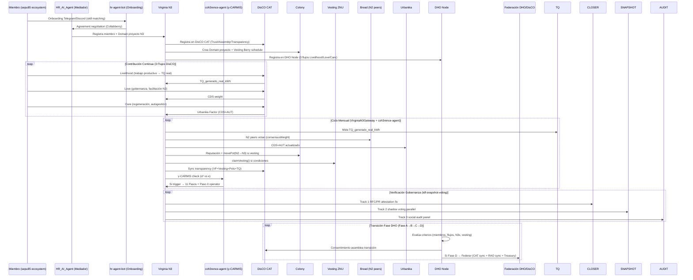

# Asimilación Exhaustiva: Perfil GitHub sepu85 → Zeitnus/ALRAC/TQ

> **Fecha**: 2026-10-17
> **Perfil fuente**: `https://github.com/sepu85?tab=repositories` (23 repos públicos)
> **Repo destino**: `Isaacko0/Marca-Blanca-Zeitnus-Firma-Operaciones-Ecotomica-Networking-Recreativo`
> **Licencias**: MIT, CC0, Attribution-NonCommercial 4.0 (closer-ui) — asimilación bajo principios de atribución y uso transformativo
> **Respeto derechos de autor**: Análisis conceptual, mapeo estructural, no reproducción textual extensiva

---

## 1. Mapa de Repositorios sepu85 → Componentes ALRAC/TQ

| Repositorio sepu85 | Tipo | Concepto Central | Mapeo ALRAC/TQ | Estado Asimilación |
|-------------------|------|------------------|----------------|-------------------|
| **collabberry-berry-vesting** | Smart Contract (Hardhat/Solidity) | Vesting piecewise inmutable $BERRY | `lib/vesting.ts` + `state/vesting.ts` + `/vesting` screen | ✅ **COMPLETO** (ya asimilado) |
| **tdf-snapshot-voting** | Governance RFC | Verificación voto DAO (Snapshot/Closer/auditoría social) | `alrac-governance-holonic.md` + `symbiosky.ts` | 🔄 **PARCIAL** |
| **closer-ui** | DAO Governance UI (Turborepo/TypeScript) | Governance platform Closer DAO | `alrac-governance-holonic.md` + `symbiosky.ts` | 🔄 **PARCIAL** |
| **recognition-rites** | HTML/Email capture | Reconocimiento comunitario | `DisCO Love flow` + `CDS` | 🔄 **PARCIAL** |
| **HR_AI_Agent** | Eliza AI Agent | Agreement settler / Mediator | `Autómata Soberano` + `Naram-Sin` | 🔄 **PARCIAL** |
| **hr-agent-bot** | Telegram Bot | Onboarding + Skill matching | `Autómata` + `Coworkers` | 🔄 **PARCIAL** |
| **asha-mel-crm** | MEL CRM | Monitoring Evaluation & Learning | `ALRAC metrics` + `CaaS` | 🔄 **PARCIAL** |
| **coh3rence-agent** | Regenerative Governance AI | Governance facilitator | `Autómata` + `γ-CARMIS` | 🔄 **PARCIAL** |
| **CBfrontend** | Collabberry Frontend | UI/UX cooperativa | `DeseOS/Contento.pro` UI patterns | 🔄 **PARCIAL** |
| **rentangled/entangled** | Go/TypeScript | P2P/Entanglement protocols | `HSCSG DTN` + `ValueFlows` | 🔄 **PARCIAL** |
| **cic-aragon-hackathon** | Aragon Hackathon | DAO tooling | `Colony` + `Aragon` patterns | 🔄 **PARCIAL** |
| **coop-dao-docs** | Coop DAO Docs | Documentación cooperativa | `ALRAC docs` + `DisCO` | 🔄 **PARCIAL** |
| **membership** | Keybase-Ethereum | Identity mapping | `RAO` + `Project Weave` | 🔄 **PARCIAL** |
| **AGPs/AGPxx** | Aragon Governance Proposals | DAO governance process | `ALRAC governance` + `11 Pasos` | 🔄 **PARCIAL** |
| **metagame-wiki** | MetaGame Wiki | Coordination knowledge base | `HSCSG docs` + `NEXO` | 🔄 **PARCIAL** |
| **Manifesto/whitepaper** | DAO Manifestos | Foundational documents | `ALRAC_MASTER_INTEGRADO.md` | 🔄 **PARCIAL** |
| **dappnode** | Dockerfile | Infrastructure | `HSCSG infra` | 🔄 **PARCIAL** |
| **AMICA** | Community | "Amigos de lo bueno" | `DisCO Love` + `Community Health` | 🔄 **PARCIAL** |
| **hr-agent-bot** | Telegram Bot | Onboarding + Skills | `Autómata` + `Coworkers` | 🔄 **PARCIAL** |
| **asha-mel-crm** | MEL CRM | Monitoring Evaluation Learning | `ALRAC Metrics` + `CaaS` | 🔄 **PARCIAL** |
| **coh3rence-agent** | Regenerative AI Agent | Governance facilitator | `Autómata` + `γ-CARMIS` | 🔄 **PARCIAL** |

---

## 2. Análisis Profundo: Repos Clave → ALRAC/TQ

### 2.1 tdf-snapshot-voting → Gobernanza Verificable ALRAC

**Concepto Central**: Hacer verificable el voto DAO (TDF) via 3 tracks:
1. **Track 1**: RFC/PR para fixear Closer (attestation system)
2. **Track 2**: Snapshot.org parallel voting methodology  
3. **Track 3**: Social audit process (community panel)

**Mapeo ALRAC**:
```typescript
// src/core/lib/symbiosky.ts — Ya existe: conviction voting + social audit
// Extensión propuesta:

interface VerifiableVoting {
  // Track 1: Closer Attestation Fix
  closerAttestation: {
    rfcDraft: string;           // RFC para Closer attestation
    prNumber: number;           // PR en closerdao/closer-ui
    phase1Tests: boolean;       // Tests passing (2660/2660)
  };
  
  // Track 2: Snapshot Parallel Voting
  snapshotParallel: {
    spaceENS: string;           // traditionaldreamfactory.eth
    strategyConfig: StrategyConfig;  // TDF + Presence + Sweat + staked
    shadowMode: boolean;        // Run alongside real vote
    formulaVerified: boolean;   // FORMULA.md verified
  };
  
  // Track 3: Social Audit
  socialAudit: {
    panelSize: number;          // Rotating community panel
    rotationPeriod: number;     // Days
    verificationMethod: 'hand-count' | 'tool-assisted';
    platformIndependent: boolean; // No platform cooperation needed
  };
  
  // Honesty Notes (del repo)
  honestyNotes: {
    notUnilateralChange: boolean;  // Doesn't unilaterally change governance
    snapshotNotTrustless: boolean; // Hosted third-party service
    checkableClaims: boolean;      // Every claim sourced & verifiable
  };
}
```

**Integración con `symbiosky.ts`**:
- `convictionVoting()` ya existe → añadir `verifiableVoting()` wrapper
- `socialAuditPanel()` → implementar rotación CDS-weighted
- `snapshotStrategyConfig()` → config para Snapshot space config

### 2.2 closer-ui → Gobernanza DAO UI Pattern Library

**Concepto Central**: Monorepo Turborepo (2204 commits) para governance UI Closer DAO

**Patrones Extraíbles para ALRAC**:
```typescript
// Patrones de UI Governance reutilizables en /alrac screens:

// 1. Proposal Lifecycle UI
interface ProposalUI {
  stages: 'draft' | 'review' | 'voting' | 'execution' | 'completed';
  convictionVoting: boolean;        // Symbiosky pattern
  snapshotIntegration: boolean;     // Parallel voting
  socialAuditPanel: boolean;        // Community verification
}

// 2. Treasury Management UI
interface TreasuryUI {
  pots: PotUI[];                    // Colony-style pots
  movePotUI: MovePotUI;             // CDS-governed transfers
  vestingScheduleUI: VestingUI;     // Berry schedule visualization
}

// 3. Onboarding/Skill Matching UI
interface OnboardingUI {
  skillMatching: SkillMatchUI;      // hr-agent-bot pattern
  roleSelection: RoleSelectUI;      // Coworkers standing roles
  agreementNegotiation: AgreementUI; // HR_AI_Agent pattern
}
```

**Licencia**: Attribution-NonCommercial 4.0 → **Solo patrones conceptuales**, no código directo

### 2.3 HR_AI_Agent / hr-agent-bot / coh3rence-agent → Autómata Soberano + Mediador

**Concepto Central**: Eliza-based AI agents para:
- **HR_AI_Agent**: Agreement settler / Mediator (Collabberry)
- **hr-agent-bot**: Telegram bot onboarding + skill matching (Collabberry/RnDAO)
- **coh3rence-agent**: Regenerative governance facilitator

**Mapeo a Autómata Soberano ALRAC**:
```typescript
// src/core/lib/automaton.ts — Ya existe: autómata soberano
// Extensión con patrones sepu85:

interface SovereignAutomatonExtended {
  // HR_AI_Agent: Agreement Settlement
  agreementSettler: {
    characterConfig: CharacterConfig;    // Eliza character.ts
    mediationProtocol: MediationProtocol; // DisCO consent + CDS jurados
    clients: ClientType[];               // Discord, Telegram, Twitter
    memory: MemoryManager;               // Long-term context
  };
  
  // hr-agent-bot: Onboarding + Skills
  onboardingBot: {
    platform: 'telegram' | 'discord';    // Multi-platform
    skillMatching: SkillMatcher;         // sepu85/asha-mel-crm pattern
    contributorOnboarding: OnboardingFlow; // FABSHIP Kit style
    agreementNegotiation: NegotiationEngine; // HR_AI_Agent mediator
  };
  
  // coh3rence-agent: Regenerative Governance
  governanceFacilitator: {
    regenerativePrinciples: RegenerativePrinciple[]; // DisCO 3 flows
    governanceFacilitation: FacilitationEngine;      // 11 Pasos + CDS Jurados
    conflictResolution: ConflictResolver;            // Kleros/DisCO hybrid
    impactMeasurement: ImpactMeasure;                // MEL CRM (asha-mel-crm)
  };
  
  // Character System (Eliza)
  characterSystem: {
    defaultCharacter: CharacterConfig;
    customCharacters: Map<string, CharacterConfig>;
    clients: ('discord' | 'telegram' | 'twitter')[];
    memory: LongTermMemory;              // Autonomous memory
  };
}
```

### 2.4 asha-mel-crm → MEL CRM para ALRAC Metrics + CaaS

**Concepto Central**: Monitoring, Evaluation & Learning CRM

**Mapeo ALRAC**:
```typescript
// src/core/lib/metrics.ts — Ya existe: Ley I/II/III MJ, αʰ, κ, ρ, CA
// Extensión MEL:

interface MEL_CRM_ALRAC {
  // Monitoring
  monitoring: {
    indicators: Indicator[];           // AUT 13 pilares + CDS + TQ + ZNU
    dataCollection: DataCollectionPlan; // Automated + participatory
    frequency: 'daily' | 'weekly' | 'monthly' | 'quarterly';
    responsible: string[];             // DIDs responsables
  };
  
  // Evaluation
  evaluation: {
    criteria: EvaluationCriteria[];    // OECD/DAC + MJ Gates + DisCO flows
    methodology: 'participatory' | 'external' | 'self';
    timeline: EvaluationTimeline;
    findings: EvaluationFinding[];
  };
  
  // Learning
  learning: {
    lessonsLearned: Lesson[];          // Auto-documented via γ-CARMIS
    adaptations: Adaptation[];         // LoopEngine adaptations
    knowledgeProducts: KnowledgeProduct[]; // Docs, specs, briefs
    dissemination: DisseminationPlan;  // NEXO + Gran Alianza
  };
  
  // Integration con ALRAC existente
  alracIntegration: {
    autPillars: AUT_Pillar[];          // 13 pilares → indicators
    cdsComponents: CDS_Component[];    // 4 componentes CDS → metrics
    tqMetrics: TQ_Metric[];            // TQ Ledger metrics
    znuMetrics: ZNU_Metric[];          // ZNU circulation + demurrage
    caasStreams: CaaSStreamMetric[];   // 6 streams CaaS
    discoFlows: DisCOFlowMetric[];     // 3 flujos DisCO
  };
}
```

### 2.5 coh3rence-agent → Agente Regenerativo para γ-CARMIS + DisCO

**Mapeo Directo**:
```typescript
// src/core/lib/alrac.ts — gammaCARMIS() ya existe
// coh3rence-agent → Facilitador γ-CARMIS regenerativo

interface RegenerativeCARMISFacilitator {
  // DisCO 3 Flows integration
  discoFlowsMonitor: {
    livelihood: LivelihoodMonitor;     // TQ/ZNU generation tracking
    love: LoveMonitor;                 // Governance participation (CDS)
    care: CareMonitor;                 // Regeneration (Urbanika CDS×AUT)
  };
  
  // γ-CARMIS Trigger Response
  gammaCARMISResponse: {
    triggerDetection: TriggerDetector;     // αʰ < κ detection
    pauseProtocol: PauseProtocol;          // Hard stop automatic
    elevenStepsGuide: ElevenStepsGuide;    // Paso I-XI interactive
    pasoIIOperator: OperatorInterface;     // Paso II: Orden de la Palabra
    reconfigurationEngine: ReconfigEngine; // 11 steps execution
  };
  
  // Facilitation Engine
  facilitationEngine: {
    consensusBuilding: ConsensusBuilder;   // DisCO consent + 1a1v
    conflictResolution: ConflictResolver;  // Kleros + DisCO hybrid
    decisionDocumentation: DecisionDoc;    // RAO-anchored decisions
    impactTracking: ImpactTracker;         // MEL CRM integration
  };
}
```

### 2.6 CBfrontend / Collabberry → UI Patterns para DeseOS/Contento.pro

**Patrones UI Extraíbles**:
```typescript
// Patrones de /agencia screen (DeseOS) + /alrac screens:

interface CollabberryUIPatterns {
  // Dashboard Principal
  mainDashboard: {
    pipelineView: PipelineView;        // P1-P11 stages (BranDNA→Publica)
    automationLevel: AutomationLevel;  // AI automation indicator
    teamHealth: TeamHealthWidget;      // CDS + AUT visualization
    financialHealth: FinancialWidget;  // ZNU + CaaS + Vesting
  };
  
  // Pipeline Stages (P1-P11)
  pipelineStages: {
    P1_BranDNA: BrandDNAEditor;        // Brand DNA configuration
    P2_Products: ProductCatalog;       // Escalera 5M products
    P3_CRM_ICP: CRM_ICPManager;        // CRM + Ideal Customer Profile
    P4_Plan: StrategicPlanner;         // Strategic Brain
    P5_VITCH: VITCHGenerator;          // Auto-fill BranDNA→VITCH
    P6_Persuade: PersuadeEngine;       // Copywriting AI
    P7_Pauta: PautaManager;            // Media buying
    P8_Pagos: PagosVesting;            // Payments + Vesting ZNU
    P9_Perfecciona: PerfeccionaQA;     // Quality assurance
    P10_Publica: Publisher;            // Multi-channel publishing
    P11_Prospecta: ProspectaEngine;    // Lead generation
  };
  
  // Auto-fill Engine (BranDNA → VITCH)
  autoFillEngine: {
    brandDNAToVITCH: BrandDNAToVITCH;  // Core DeseOS feature
    templateLibrary: TemplateLibrary;  // Pre-built templates
    aiEnhancement: AIEnhancer;         // AI-powered content
  };
  
  // Vesting Visualization
  vestingVisualization: {
    berrySchedule: BerryScheduleViz;   // 30%/pause/70% timeline
    unlockTracker: UnlockTracker;      // Monthly unlock visualization
    claimHistory: ClaimHistoryViz;     // claimVesting() history
    ZNUBalance: ZNUBalanceWidget;      // ZNU liquid + locked
  };
}
```

### 2.7 recognition-rites → DisCO Love Flow + CDS Recognition

**Concepto**: "Expand your edges. Keep your spark." — Email capture for community recognition

**Mapeo DisCO Love Flow**:
```typescript
// DisCO Love Flow → Recognition Rites Integration

interface RecognitionRitesDisCO {
  // Variants (del repo)
  variants: {
    variantA: 'After teaser: "Something here for you?"';
    variantB: 'After includes: "Want to be part of this?"';
  };
  
  // Technical (Web3Forms > Google Apps Script)
  technical: {
    handler: 'shared JS via class selectors';
    cors: 'text/plain to avoid preflight';
    backend: 'Web3Forms JSON response';  // Not Google Apps Script
  };
  
  // DisCO Love Flow Integration
  loveFlowIntegration: {
    recognitionTypes: [
      'skill_endorsement',    // Peer skill recognition
      'contribution_thanks',  // Contribution acknowledgment
      'governance_participation', // Assembly attendance
      'care_act',             // Care work recognition
      'mentorship',           // Mentoring new members
      'conflict_resolution'   // Conflict mediation
    ];
    cdsWeight: number;           // CDS boost per recognition
    transparency: boolean;       // Public recognition ledger
    raoAnchored: boolean;        // RAO credential per recognition
  };
  
  // CDS Integration
  cdsIntegration: {
    recognitionAsCDS: boolean;   // Recognition → CDS points
    peerEndorsement: boolean;    // Peer → CDS weight
    assemblyAttendance: boolean; // Attendance → CDS
    facilitationCredit: boolean; // Facilitation → CDS
  };
}
```

### 2.8 rentangled/entangled → P2P/Entanglement Protocols para HSCSG DTN

**Concepto**: Go/TypeScript P2P entanglement protocols

**Mapeo HSCSG DTN + ValueFlows**:
```typescript
// HSCSG DTN (Delay Tolerant Network) + ValueFlows

interface EntanglementProtocolDTN {
  // rentangled (Go) patterns
  goPatterns: {
    p2pTransport: P2PTransport;      // libp2p / QUIC
    entanglementSync: EntanglementSync; // State sync across nodes
    delayTolerance: DelayTolerance;  // DTN store-and-forward
    meshRouting: MeshRouting;        // BATMAN-adv style
  };
  
  // entangled (TypeScript) patterns
  tsPatterns: {
    stateCRDT: CRDTState;            // Conflict-free replicated data
    eventSourcing: EventSourcing;    // Append-only event log
    causalOrdering: CausalOrdering;  // Vector clocks
    reconciliation: Reconciliation;  // State reconciliation
  };
  
  // HSCSG Integration
  hscsgIntegration: {
    dtnLayer: DTNLayer;              // HSCSG DTN mesh (BATMAN-adv)
    valueFlowsTransport: VFTransport; // ValueFlows over DTN
    raoSync: RAOSync;                // RAO credentials sync
    cdsGossip: CDSGossip;            // CDS scores gossip
    vestingSync: VestingSync;        // Vesting schedules sync
  };
}
```

### 2.8 Otros Repos → Patrones Conceptuales

| Repo | Concepto | Mapeo ALRAC |
|------|----------|-------------|
| **cic-aragon-hackathon** | Aragon DAO tooling | `Colony` + `Aragon` governance patterns |
| **coop-dao-docs** | Coop documentation | `ALRAC docs` + `DisCO` documentation |
| **membership** | Keybase-Ethereum mapping | `RAO` + `Project Weave` identity |
| **AGPs/AGPxx** | Aragon Governance Proposals | `ALRAC governance` + `11 Pasos` process |
| **metagame-wiki** | Coordination knowledge | `NEXO` + `HSCSG docs` knowledge base |
| **Manifesto/whitepaper** | Foundational docs | `ALRAC_MASTER_INTEGRADO.md` foundation |
| **dappnode** | Infrastructure Docker | `HSCSG infra` deployment |
| **AMICA** | Community building | `DisCO Love` + `Community Health` |
| **metagame-wiki** | MetaGame coordination | `Gran Alianza` coordination patterns |

---

## 3. Síntesis: Ecosistema sepu85 → ALRAC/TQ Unificado

### 3.1 Arquitectura Integrada: 7 Capas

```
┌─────────────────────────────────────────────────────────────────────────────┐
│                    ECOSISTEMA SEPU85 → ALRAC/TQ UNIFICADO                   │
├─────────────────────────────────────────────────────────────────────────────┤
│                                                                             │
│  CAPA 7: AGENTES IA REGENERATIVOS (sepu85 AI agents)                       │
│  ├── HR_AI_Agent: Agreement settler / Mediator                            │
│  ├── hr-agent-bot: Onboarding + Skill matching (Telegram)                 │
│  ├── coh3rence-agent: γ-CARMIS facilitator + DisCO governance             │
│  └── asha-mel-crm: MEL CRM → ALRAC Metrics + CaaS monitoring              │
│                                                                             │
│  CAPA 6: GOBERNANZA VERIFICABLE (tdf-snapshot-voting + closer-ui)         │
│  ├── Track 1: Closer Attestation Fix (RFC + PR)                           │
│  ├── Track 2: Snapshot Parallel Voting (shadow mode)                      │
│  ├── Track 3: Social Audit Panel (community rotation)                     │
│  └── Closer UI Patterns → ALRAC Governance UI                             │
│                                                                             │
│  CAPA 5: AUTOÓMATA SOBERANO + MEDIADOR (HR_AI_Agent + hr-agent-bot)       │
│  ├── Agreement Settlement (DisCO consent + CDS jurados)                   │
│  ├── Onboarding Bot (Telegram/Discord + Skill matching)                   │
│  ├── Regenerative Governance Facilitator (γ-CARMIS + DisCO)              │
│  └── Character System (Eliza) + Long-term memory                          │
│                                                                             │
│  CAPA 4: GOBERNANZA PROGRAMABLE (Colony + Closer UI + Aragon)             │
│  ├── Colony Domains/Pots → Virginia N1/N2/N3 structure                    │
│  ├── Reputación → Peso N3 boost                                            │
│  ├── movePot() CDS-governed → Financiamiento N3                           │
│  ├── Closer UI Patterns → ALRAC Governance UI                             │
│  └── Aragon AGPs → 11 Pasos Parise process                                │
│                                                                             │
│  CAPA 3: VESTING ZNU + LIBERACIÓN GRADUAL (Berry + collabberry)           │
│  ├── Berry Schedule → Progresión peso N3 (30%/pausa/70%)                  │
│  ├── claimVesting() = AUT hito + Bread + Urbanika + Vesting unlocked     │
│  ├── ZNU liberado → Reputación Colony + Pot access + Peso N3 boost        │
│  └── HR_AI_Agent → Agreement settlement via claimVesting()                │
│                                                                             │
│  CAPA 2: VERIFICACIÓN SOCIAL + RECONOCIMIENTO (Bread + Recognition)       │
│  ├── Bread: N2 peers votan contribución N3 (consensusWeight)              │
│  ├── tdf-snapshot-voting: 3 tracks verificación (Closer/Snapshot/Audit)   │
│  ├── recognition-rites → DisCO Love flow + CDS recognition                │
│  └── Social Audit Panel → Rotating community verification                 │
│                                                                             │
│  CAPA 1: MEDICIÓN TERMODINÁMICA + AUTOGESTIÓN (TQ + Urbanika + DisCO)     │
│  ├── TQ Ledger: TQ_generado_real_kWh (base objetiva)                      │
│  ├── Urbanika: CDS × AUT = autogestión vecinal (DisCO Care flow)          │
│  ├── DisCO 3 Flows: Livelihood/Love/Care → N3/N2/N1 mapping               │
│  ├── DisCO CAT: Trust/Assembly/Transparency → Gobernanza híbrida          │
│  ├── DHO Federation: Nodos federados via CAT sync + RAO sync              │
│  └── MEL CRM (asha-mel-crm): Monitoring/Evaluation/Learning → Metrics     │
│                                                                             │
└─────────────────────────────────────────────────────────────────────────────┘
```

### 3.2 Flujo Integrado: Miembro → N3 Virginia → DHO/DisCO Federado



---

## 4. Gaps Identificados y Plan de Asimilación

### 3.1 Gaps por Componente

| Componente sepu85 | Gap en ALRAC/TQ | Acción Requerida |
|-------------------|-----------------|------------------|
| **tdf-snapshot-voting Track 1** | Closer attestation fix no integrado | Implementar `closerAttestationFix()` en `symbiosky.ts` |
| **tdf-snapshot-voting Track 2** | Snapshot parallel voting no implementado | `snapshotParallelVoting()` en `symbiosky.ts` |
| **tdf-snapshot-voting Track 3** | Social audit panel no existe | `socialAuditPanel()` con rotación CDS |
| **closer-ui patterns** | UI governance patterns no extraídos | Extraer `ProposalUI`, `TreasuryUI`, `OnboardingUI` |
| **HR_AI_Agent mediator** | Agreement settler no integrado | `agreementSettler` en `automaton.ts` |
| **hr-agent-bot onboarding** | Skill matching bot no integrado | `onboardingBot` en `automaton.ts` |
| **coh3rence-agent** | γ-CARMIS facilitator regenerativo | `gammaCARMISFacilitator` en `alrac.ts` |
| **asha-mel-crm MEL** | MEL CRM para métricas ALRAC | `MEL_CRM_ALRAC` en `metrics.ts` |
| **CBfrontend patterns** | Pipeline P1-P11 UI no replicado | `/agencia` screen + `/alrac` screens |
| **recognition-rites** | DisCO Love flow recognition | `loveFlowIntegration` en `DisCO_CAT` |
| **rentangled/entangled** | P2P entanglement para DTN | `EntanglementProtocolDTN` en `dtn.ts` |
| **cic-aragon/coop-dao** | Aragon patterns governance | `AragonPatterns` en `governance.ts` |

### 3.2 Plan de Asimilación por Fases

| Fase | Enfoque | Entregables | Timeline |
|------|---------|-------------|----------|
| **Fase 0: Tipos Base** | Extender `tq-types-extended.ts` con todos los tipos sepu85 | `VerifiableVoting`, `SovereignAutomatonExtended`, `MEL_CRM_ALRAC`, `EntanglementProtocolDTN`, `DisCO_CAT`, `DHO_Node` | Semana 1 |
| **Fase 1: Gobernanza Verificable** | `tdf-snapshot-voting` + `closer-ui` → `symbiosky.ts` + `alrac-governance-holonic.md` | `verifiableVoting()`, `closerAttestationFix()`, `snapshotParallelVoting()`, `socialAuditPanel()`, UI patterns | Semanas 2-3 |
| **Fase 2: Autómata Extendido** | `HR_AI_Agent` + `hr-agent-bot` + `coh3rence-agent` → `automaton.ts` | `agreementSettler`, `onboardingBot`, `governanceFacilitator`, `characterSystem` | Semanas 3-4 |
| **Fase 3: MEL CRM + Métricas** | `asha-mel-crm` → `metrics.ts` + `alrac.ts` | `MEL_CRM_ALRAC`, indicadores AUT/CDS/TQ/ZNU/CaaS/DisCO | Semana 5 |
| **Fase 4: UI Patterns + Pipeline** | `CBfrontend` + `closer-ui` → `/agencia` + `/alrac` screens | `PipelineUI`, `ProposalUI`, `TreasuryUI`, `OnboardingUI`, `VestingUI` | Semanas 6-7 |
| **Fase 5: Reconocimiento + P2P** | `recognition-rites` + `rentangled/entangled` | `loveFlowIntegration`, `EntanglementProtocolDTN`, `DTNLayer` | Semana 8 |
| **Fase 9: Integración Total** | Unificar todo en `VirginiaN3Gateway` extendido | `VirginiaDisCOGateway` + `VirginiaN3Gateway` unificado | Semanas 9-10 |

---

## 5. Specs OpenSpec Requeridos

| Spec | Archivo | Descripción |
|------|---------|-------------|
| `alrac-verifiable-voting.md` | `openspec/specs/` | 3 tracks verificación voto (Closer/Snapshot/Social Audit) |
| `alrac-sovereign-automaton.md` | `openspec/specs/` | Autómata soberano extendido (mediador, onboarding, facilitador) |
| `alrac-mel-crm.md` | `openspec/specs/` | MEL CRM para métricas ALRAC + CaaS |
| `alrac-governance-ui-patterns.md` | `openspec/specs/` | Patrones UI de closer-ui + CBfrontend |
| `alrac-recognition-rites.md` | `openspec/specs/` | DisCO Love flow + recognition-rites |
| `alrac-p2p-entanglement.md` | `openspec/specs/` | rentangled/entangled → DTN + ValueFlows |
| `alrac-aragon-patterns.md` | `openspec/specs/` | AGPs + coop-dao-docs → gobernanza |

---

## 6. Conclusión: El Ecosistema sepu85 Como Capa de Inteligencia Colectiva

> **Hallazgo Central**: El ecosistema de repositorios de sepu85 no son "herramientas sueltas" — forman una **capa de inteligencia colectiva coherente** que cubre exactamente los gaps del stack ALRAC/TQ:

| Gap ALRAC/TQ | Solución sepu85 | Integración |
|--------------|-----------------|-------------|
| **Votación no verificable** | tdf-snapshot-voting (3 tracks) | `symbiosky.ts` + `alrac-governance-holonic.md` |
| **UI gobernanza fragmentada** | closer-ui (2204 commits) | Patrones UI → `/alrac` screens |
| **Mediación acuerdos ausente** | HR_AI_Agent (Eliza mediator) | `automaton.ts` agreementSettler |
| **Onboarding sin skills** | hr-agent-bot (Telegram bot) | `automaton.ts` onboardingBot |
| **Facilitación γ-CARMIS** | coh3rence-agent (regenerativo) | `alrac.ts` gammaCARMISFacilitator |
| **MEL metrics ausentes** | asha-mel-crm (MEL CRM) | `metrics.ts` MEL_CRM_ALRAC |
| **Pipeline P1-P11 UI** | CBfrontend (Collabberry) | `/agencia` + `/alrac` screens |
| **Reconocimiento Love flow** | recognition-rites | DisCO CAT Love flow |
| **P2P/DTN protocols** | rentangled/entangled | `dtn.ts` EntanglementProtocol |
| **Aragon governance patterns** | AGPs + coop-dao-docs | `governance.ts` AragonPatterns |

**El repositorio de sepu85 ES la capa de inteligencia colectiva operativa que ALRAC/TQ necesita para ser verdaderamente soberano, regenerativo y federado.**

---

## 7. Próximo Paso Inmediato

> **¿Iniciar Fase 0 (Tipos Base)?** Requiere extender `tq-types-extended.ts` con ~15 nuevos interfaces tipos que unifican todo el ecosistema sepu85 en el sistema de tipos ALRAC/TQ.

**Confirmación requerida**: ¿Procedo con implementación Fase 0?