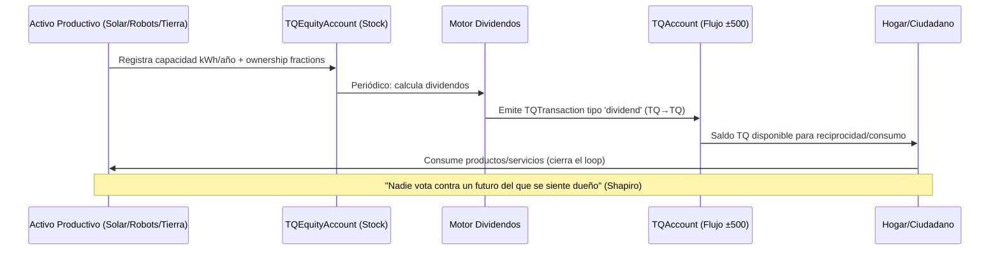

# Propuesta: TQ Post-Labor — De Contabilidad Energética a Propiedad Productiva Distribuida

> **Inspiración**: Análisis de David Shapiro "You Will Own EVERYTHING and Be Happy" (economía post-trabajo)
> **Respeto de derechos de autor**: Esta propuesta usa conceptos públicos de economía post-trabajo; no reproduce contenido protegido del video.
> **Objetivo**: Evolucionar TQ (Transducción Quántica) de ledger de reciprocidad a **infraestructura de propiedad productiva distribuida** alineada con economía post-trabajo.

---

## 1. Diagnóstico: El Desencaje Actual

### 1.1 Lo que dice Shapiro (resumen conceptual, no cita textual)
- **Abundancia técnica**: IA + robótica eliminan el esfuerzo humano como cuello de botella
- **Crisis de legitimidad**: Miedo a desempleo + concentración de riqueza → oposición política (ej. $130B bloqueados en data centers Q1 2026)
- **Problema salarial**: Parte laboral del PIB cayó 60-66% → <53% (mínimo histórico)
- **Insight clave**: "Un salario es una bomba de mano. Una participación accionaria es una tubería a la torre de agua."
- **Solución**: Recalibrar para que **cada ciudadano tenga participación directa en medios de producción** (stocks, no solo flows)
- **Modelos de propiedad**: Personal, colectiva, municipal, estatal (dividendo Alaska), federal

### 1.2 Lo que TQ hace hoy (Capa 1 ALRAC)
| Componente | Estado Actual | Gap vs Post-Labor |
|------------|---------------|-------------------|
| **TQAccount** | Saldo ±500, transacciones reciprocidad/producción/regeneración | No modela "participación accionaria" en capacidad productiva |
| **ProductFederation** | Catálogo ICE/Ecoinvent por producto | No vincula productos a **capacidad productiva poseída** |
| **LandRegistry** | Tierras ancladas kWh/año | No emite **dividendos TQ** a propietarios/gestores |
| **CrossNodePools** | Liquidez cross-nodo | No distingue **capital** (capacidad) vs **flujo** (producción) |
| **CommunityFund** | β_crit → fondo comunitario | No es **dividendo universal** por propiedad |
| **AutonomyMetrics** | % decisiones locales | No mide **propiedad efectiva** de medios de producción |

### 1.3 Contradicción Central
> **TQ = 1 kWh (físico)** pero **no modela quién posee la capacidad de generar esos kWh**.
> Shapiro: "Si solo unos pocos poseen las máquinas, el 90% del valor se concentra. Conecta cada hogar y el dinero fluye por cada tubería."

**TQ hoy es "cinta métrica de reciprocidad" (Postulado 4: no acumulable). Necesita capa de "propiedad productiva" (acumulable, heredable, divisible).**

---

## 2. Propuesta Arquitectónica: TQ Dual-Layer

### 2.1 Dos Capas, Una Lógica (Principio Anfibio HSCSG)

```
┌─────────────────────────────────────────────────────────────────┐
│ TQ CAPA FLUJO (Existente) — Postulado 4: No Acumulable         │
│ ├── TQAccount.balance: ±500 (reciprocidad, producción, regeneración)  │
│ ├── Transacciones: TQ ↔ TQ únicamente (exchangeGuard)          │
│ └── Función: Cinta métrica de intercambio presente             │
├─────────────────────────────────────────────────────────────────┤
│ TQ CAPA STOCK (Nueva) — Propiedad Productiva Acumulable        │
│ ├── TQEquityAccount: Sin límite ±500 (representa capacidad)    │
│ ├── TQShare: Fracción de capacidad productiva (tierra, solar, robots, datos)    │
│ ├── TQDividend: Flujo automático kWh/año → TQ (capacidad → cuenta flujo)        │
│ └── Función: "Tubería a la torre de agua" (Shapiro)            │
└─────────────────────────────────────────────────────────────────┘
```

**Regla de oro**: Capa Stock **alimenta** Capa Flujo vía dividendos, nunca al revés. Prohibición cambiaria se mantiene en ambas.

### 2.2 Mapeo Modelos Shapiro → TQ Stock

| Modelo Shapiro | Implementación TQ Stock | Archivo/Componente |
|----------------|------------------------|---------------------|
| **Personal** (ahorros, casa, jubilación) | `TQEquityAccount` individual + `TQShare` en LandRegistry/ProductiveAsset | `tq-equity.ts`, `land.ts` |
| **Colectiva** (coops, employee-owned, credit unions) | `CrossNodePool` tipo **equity** (no solo liquidez) + gobernanza harmony-weighted | `pools-equity.ts` |
| **Municipal** (ciudad dueña de granja solar) | `MunicipalNode` con `CommunityFund` tipo **dividendo universal** | `municipal-equity.ts` |
| **Estatal** (dividendo Alaska - petróleo) | `RegionalDividendFund` → reparto TQ per cápita desde activos energéticos regionales | `regional-dividend.ts` |
| **Federal** (fondo nacional dividendos) | `FederalTQDividend` agregador de nodos/regiones | `federal-dividend.ts` |

---

## 3. Especificación Técnica: Nuevos Componentes

### 3.1 TQEquityAccount — Cuenta de Propiedad (Stock)

```typescript
// src/core/lib/tq-equity.ts (NUEVO)

export interface TQEquityAccount {
  id: string;
  holderId: string;              // DID persona/nodo/entidad
  nodeId: string;
  shares: TQShare[];             // Participaciones en activos productivos
  totalEquityKwhYear: number;    // Capacidad total poseída (kWh/año)
  createdAt: number;
  updatedAt: number;
  status: 'active' | 'frozen' | 'inherited' | 'transferred';
}

export interface TQShare {
  id: string;
  assetId: string;               // LandRegistryEntry.id | ProductiveAsset.id
  assetType: 'land' | 'solar' | 'wind' | 'hydro' | 'robotics' | 'compute' | 'data' | 'water';
  fraction: number;              // 0.0 - 1.0 (fracción poseída)
  annualKwhCapacity: number;     // kWh/año que genera esta fracción
  acquisitionDate: number;
  acquisitionType: 'purchase' | 'inheritance' | 'grant' | 'labor-contribution' | 'community-allocation';
  raoCredentialId: string;       // Anclaje RAO: procedencia, emisor, permisos, estado, revocación
  transferable: boolean;         // true = heredable/ventable (con restricciones)
  governanceRights: GovernanceRights;
}

export interface GovernanceRights {
  voteWeight: number;            // φʰ = 0.95^k * (1 + αʰ/10) * fraction
  dividendRight: boolean;        // Derecho a dividendo TQ
  vetoPower: boolean;            // Solo para activos críticos (agua, tierra comunal)
}

export interface ProductiveAsset {
  id: string;
  name: string;
  type: TQShare['assetType'];
  totalAnnualKwh: number;        // Capacidad total kWh/año
  location: { nodeId: string; geometry?: any };
  stewards: string[];            // DIDs gestores
  ownership: OwnershipStructure;
  iceCode: string;
  ecoinventVersion: string;
  raoCredentialId: string;
  registeredAt: number;
}

export interface OwnershipStructure {
  // Soporta todos los modelos Shapiro
  personal: Record<string, number>;      // holderId → fraction
  collective: Record<string, number>;    // poolId → fraction
  municipal: Record<string, number>;     // municipalityId → fraction
  state: Record<string, number>;         // regionId → fraction
  federal: number;                       // fraction federal
  unallocated: number;                   // fraction disponible
  // Suma = 1.0
}
```

### 3.2 Motor de Dividendos TQ — Flujo Stock → Flujo

```typescript
// src/core/lib/tq-dividend.ts (NUEVO)

export interface TQDividendPolicy {
  nodeId: string;
  frequency: 'daily' | 'weekly' | 'monthly' | 'annual';
  distributionRule: 'pro-rata-equity' | 'per-capita' | 'hybrid' | 'needs-weighted';
  // hybrid: 50% pro-rata equity, 50% per-capita (modelo Alaska)
  // needs-weighted: integra vectores AUT (base material)
  reserveRatio: number;          // % capacidad retenida para reinversión/mantenimiento (ej: 0.20)
  minDividendTQ: number;         // Piso garantizado (ej: 50 TQ/mes = canasta básica)
  maxDividendTQ: number;         // Techo anti-acaparamiento (β_crit aplicado a dividendos)
}

export interface DividendCalculation {
  period: { start: number; end: number };
  totalCapacityKwh: number;      // Σ asset.annualKwhCapacity * fraction
  reservedKwh: number;           // totalCapacityKwh * reserveRatio
  distributableKwh: number;      // totalCapacityKwh - reservedKwh
  distributions: DividendDistribution[];
  policy: TQDividendPolicy;
  timestamp: number;
}

export interface DividendDistribution {
  recipientId: string;           // TQEquityAccount.holderId
  recipientType: 'personal' | 'collective' | 'municipal' | 'state' | 'federal';
  equityKwh: number;             // kWh poseídos en el período
  dividendTQ: number;            // TQ recibidos (= kWh distribuidos * fracción)
  flowAccountId: string;         // TQAccount destino (capa flujo)
  timestamp: number;
}

export function calculateDividends(
  nodeId: string,
  policy: TQDividendPolicy,
  period: { start: number; end: number }
): DividendCalculation {
  // 1. Obtener todos los TQEquityAccount activos del nodo
  // 2. Sumar totalEquityKwhYear → totalCapacityKwh
  // 3. Aplicar reserveRatio → distributableKwh
  // 4. Según distributionRule:
  //    - pro-rata: dividendTQ = distributableKwh * (equityKwh / totalCapacityKwh)
  //    - per-capita: dividendTQ = distributableKwh / numRecipients
  //    - hybrid: 0.5 * pro-rata + 0.5 * per-capita
  //    - needs-weighted: integra AUT.vectors.baseMaterial
  // 5. Aplicar minDividendTQ / maxDividendTQ (β_crit)
  // 6. Generar transacciones TQTransaction tipo 'dividend' → TQAccount.flow
  // 7. Registrar en RAOLog
}

export interface DividendExecutionResult {
  success: boolean;
  distributionsExecuted: number;
  totalTQDistributed: number;
  blocked: DividendDistribution[];  // Si flowAccount congelado, >±500, etc.
  errors: string[];
  timestamp: number;
}

export async function executeDividends(
  calculation: DividendCalculation
): Promise<DividendExecutionResult> {
  // Ejecuta transacciones TQ fluido: System → TQAccount (tipo 'dividend')
  // Valida exchangeGuard (TQ→TQ), límites ±500, cuenta activa
  // Actualiza TQEquityAccount.lastDividendAt
}
```

### 3.3 Pool de Capital (Equity Pool) — Modelo Colectivo/Municipal

```typescript
// src/core/lib/tq-equity-pools.ts (NUEVO - extiende CrossNodePool)

export type EquityPoolType = 
  | 'cooperative'        // Coop trabajadores / consumidores
  | 'municipal'          // Ciudad/ayuntamiento
  | 'regional'           // Estado/provincia
  | 'federal'            // Nacional
  | 'commons';           // Bienes comunes (agua, bosque, espectro)

export interface EquityPool extends CrossNodePool {
  type: EquityPoolType;
  // Sobrescribe/extiende:
  totalEquityKwhYear: number;        // Capacidad total del pool (no liquidez TQ)
  assetShares: Record<string, number>; // assetId → fraction poseída por pool
  members: EquityPoolMember[];
  dividendPolicy: TQDividendPolicy;  // Política propia del pool
  governance: EquityPoolGovernance;
}

export interface EquityPoolMember {
  accountId: string;                 // TQEquityAccount del miembro
  shareFraction: number;             // Fracción en el pool (0-1)
  contributionType: 'capital' | 'labor' | 'land' | 'governance' | 'mixed';
  joinedAt: number;
  votingWeight: number;              // φʰ ponderado por shareFraction
}

export interface EquityPoolGovernance extends PoolGovernance {
  admissionRule: 'consensus' | 'majority' | 'harmony-weighted' | 'one-member-one-vote';
  exitRule: 'notice-period' | 'buyback-formula' | 'community-approval';
  dividendReinvestmentRatio: number; // % dividendo reinvertido en nuevos activos
  assetAcquisitionThreshold: number; // % voto para comprar nuevo activo
}

export function createEquityPool(config: EquityPoolConfig): PoolResult {
  // Valida: mínimo 3 nodos/miembros, αʰ > κ por nodo, gobernanza coherente
  // Registra activos iniciales → OwnershipStructure.collective/state/municipal
  // Configura dividendPolicy (default: hybrid 50/50)
}

export function acquireAssetForPool(poolId: string, asset: ProductiveAsset, fraction: number): TxResult {
  // 1. Valida governance (threshold, quorum)
  // 2. Transfiere fracción de OwnershipStructure al pool
  // 3. Emite TQShare a pool (no a miembros individuales)
  // 4. Actualiza pool.totalEquityKwhYear
  // 5. RAOLog: procedencia, emisor, permisos, estado
}
```

### 3.4 Fondo Dividendo Regional/Estilo Alaska

```typescript
// src/core/lib/tq-regional-dividend.ts (NUEVO)

export interface RegionalDividendFund {
  id: string;
  regionId: string;                // Código región (MX, AR, CO, etc.)
  name: string;                    // "Fondo Dividendo Energético México"
  type: 'state' | 'federal';
  sourceAssets: string[];          // ProductiveAsset.id de propiedad estatal
  totalCapacityKwhYear: number;
  policy: RegionalDividendPolicy;
  recipients: RegionalRecipient[]; // Per cápita: todos los residentes verificados
  raoCredentialId: string;
  establishedAt: number;
}

export interface RegionalDividendPolicy {
  frequency: 'annual' | 'quarterly';
  distributionRule: 'per-capita';  // Modelo Alaska: igual para todos
  residencyRequirementMonths: number; // 12 meses residencia (estilo Alaska)
  ageThreshold: number;            // 0 = todos (incluye menores)
  reserveRatio: number;            // 0.30 (30% reinversión/infraestructura)
  inflationAdjustment: boolean;    // Ajuste por canasta básica (ICE/Ecoinvent)
}

export interface RegionalRecipient {
  did: string;                     // DID verificado (Gaia Passport / Project Weave)
  regionId: string;
  residencySince: number;
  isEligible: boolean;
  lastDividendAt: number;
}

export function calculateRegionalDividend(
  fund: RegionalDividendFund,
  period: { start: number; end: number }
): DividendCalculation {
  // 1. Filtrar recipients elegibles (residencia, edad, vivo)
  // 2. totalCapacityKwh * (1 - reserveRatio) = distributableKwh
  // 3. dividendTQ = distributableKwh / eligibleRecipients.length (per-capita)
  // 4. Aplicar inflación: ajustar por canasta_Fiat via conversionFactor
  // 5. Generar distribuciones → TQAccount.flow de cada recipient
  // 6. Reserva → CommunityFund regional para infraestructura
}
```

### 3.5 Integración con LandRegistry Existente

```typescript
// Extensión en src/core/lib/tq.ts (LandRegistryEntry)

export interface LandRegistryEntry {
  // ... campos existentes ...
  
  // NUEVOS: Propiedad productiva
  ownership: OwnershipStructure;      // Fracciones por modelo Shapiro
  productiveAssetId?: string;         // Link a ProductiveAsset (si registrado como activo)
  dividendHistory: LandDividendEntry[];
}

export interface LandDividendEntry {
  period: { start: number; end: number };
  totalKwhProduced: number;           // currentProduction.total_kWh_year
  distributions: {
    recipientId: string;
    recipientType: 'personal' | 'collective' | 'municipal' | 'state' | 'federal';
    fraction: number;
    tqAmount: number;
  }[];
  reserveKwh: number;                 // Reinversión suelo, infraestructura
  timestamp: number;
}

export function computeLandDividends(landId: string, period: Period): LandDividendEntry {
  // Usa currentProduction.total_kWh_year como capacidad real del período
  // Distribuye según ownership structure
  // Personal/collective → TQEquityAccount → TQAccount (dividendo)
  // Municipal/state/federal → RegionalDividendFund / CommunityFund
}
```

---

## 4. Flujo Completo: De Capacidad a Dividendo en Cada Hogar



---

## 5. Validación con Principios ALRAC/HSCSG

| Principio | Cumplimiento |
|-----------|--------------|
| **E=V** | Dividendos = kWh reales producidos (no emisión arbitraria) |
| **Anfibio** | Capa Stock opera igual en postmonetario (TQ offline) y conectado (ZNU/USDC vía Capa 3) |
| **TQ = 1 kWh** | Stock mide capacidad kWh/año; Flujo mide kWh intercambiados; Dividendo convierte capacidad → flujo |
| **Prohibición cambiaria** | TQ Stock ↔ TQ Flujo → TQ فقط. Nunca fiat/cripto. Capa 3 (Zeitnus) única que toca fiat vía ZNU |
| **Postulado 4 (ZNU caduca)** | TQ Flujo ±500 caduca/no acumulable. TQ Stock **sí acumulable** (es propiedad, no dinero) |
| **γ-CARMIS** | Si equity concentration > threshold → trigger reconfiguración (β_crit en equity) |
| **1a1v + CDS** | GovernanceRights.voteWeight = φʰ * fraction; pools equity usan harmony-weighted |
| **RAO** | Cada TQShare anclado a RAOCredential (procedencia, emisor, permisos, estado, revocación) |
| **Autonomía** | AutonomyMetrics incluye `equityControl: { land, energy, compute, water, robotics }` |

---

## 6. Archivos a Crear/Modificar

### 6.1 Nuevos Archivos (Capa 1 TQ - Stock)
```
src/core/lib/
├── tq-equity.ts           # TQEquityAccount, TQShare, ProductiveAsset, OwnershipStructure
├── tq-dividend.ts         # Motor dividendos Stock→Flujo, políticas, ejecución
├── tq-equity-pools.ts     # EquityPool (cooperativas, municipal, regional, federal)
├── tq-regional-dividend.ts # Fondo dividendo estilo Alaska (per-cápita)
└── tq-types-extended.ts   # Tipos unificados (re-export desde lib/)
```

### 6.2 Archivos a Modificar
```
src/core/lib/
├── tq.ts                  # + import types, + LandDividendEntry, + computeLandDividends()
├── alrac.ts               # + simulateNode() integra equity/dividendos
└── valueDual.ts           # + render dual: TQ Stock (propiedad) vs TQ Flow (reciprocidad)

src/core/state/
├── alrac.ts               # + interfaces TQEquityAccount, TQShare, EquityPool, RegionalDividendFund
├── store.ts               | + slices: equity, dividends, equityPools, regionalDividends
└── hooks/alrac.ts         # + selectores/actions tipados para nueva funcionalidad

openspec/specs/
├── alrac-tq-equity.md           # Spec Capa 1.1: Equity Accounts & Shares
├── alrac-tq-dividend.md         # Spec Capa 1.2: Dividend Engine
├── alrac-tq-equity-pools.md     # Spec Capa 1.3: Equity Pools (collective/municipal)
├── alrac-tq-regional-dividend.md # Spec Capa 1.4: Regional Dividend (Alaska model)
└── alrac-tq-capital-flow.md     # Spec Capa 1.5: Integración Stock↔Flow
```

### 6.3 Tests de Aceptación (Criterios Mínimos)

| Test | Descripción |
|------|-------------|
| **TQ-Equity-01** | Crear TQEquityAccount, asignar TQShare (land 0.5 fracción), verificar totalEquityKwhYear |
| **TQ-Dividend-01** | Política hybrid 50/50: 1000 kWh capacidad, 20% reserva → 400 TQ pro-rata + 400 TQ per-cápita |
| **TQ-Dividend-02** | Dividendo ejecutado → TQTransaction tipo 'dividend' en TQAccount.flow (verifica exchangeGuard) |
| **TQ-Pool-01** | Crear EquityPool municipal, adquirir activo solar, distribuir dividendo a residentes |
| **TQ-Regional-01** | Fondo estilo Alaska: 10M kWh/año, 100k residentes, 30% reserva → 70 TQ/habitante/año |
| **TQ-Integration-01** | simulateNode() con equity: αʰ calculado incluye equityControl, γ-CARMIS trigger si concentration > β_crit |
| **TQ-UI-01** | Pantalla /alrac tab "Propiedad" muestra: mis shares, dividendos históricos, proyección anual |

---

## 7. Secuencia de Implementación (90 Días)

| Fase | Tiempo | Entregables |
|------|--------|-------------|
| **Fase 1: Core Types + Equity Account** | Semanas 1-3 | `tq-equity.ts`, `tq-types-extended.ts`, specs equity, tests unitarios |
| **Fase 2: Dividend Engine** | Semanas 3-5 | `tq-dividend.ts`, integración LandRegistry, specs dividend, tests |
| **Fase 3: Equity Pools (Colectivo/Municipal)** | Semanas 5-7 | `tq-equity-pools.ts`, governance, specs pools, tests |
| **Fase 4: Regional Dividend (Alaska)** | Semanas 7-9 | `tq-regional-dividend.ts`, residency verification, specs, tests |
| **Fase 5: Integración + UI** | Semanas 9-12 | Store slices, hooks, pantalla /alrac tab "Propiedad", E2E tests, docs |

---

## 8. Métricas de Éxito (KPIs Post-Labor)

| Métrica | Target | Medición |
|---------|--------|----------|
| **% Hogares con TQEquity > 0** | > 80% en nodo piloto | `count(equityAccounts) / totalHouseholds` |
| **Dividendo TQ per cápita / canasta básica** | ≥ 1.0 (cubre canasta) | `avgDividendTQ / (basketFiat/500)` via conversionFactor |
| **Concentración equity (Gini)** | < 0.4 | `gini(equityKwhYear across accounts)` |
| **AutonomyRatio con equityControl** | > 0.7 | `computeAutonomyMetrics()` extendido |
| **γ-CARMIS triggers por concentración** | 0 en 12 meses | Logs γ-CARMIS |
| **Participación gobernanza equity** | > 60% miembros votan | `votes / eligibleMembers` en propuestas pool |

---

## 9. Riesgos y Mitigaciones

| Riesgo | Probabilidad | Impacto | Mitigación |
|--------|--------------|---------|------------|
| **Complejidad dual-layer confunde usuarios** | Alta | Medio | UI clara: "Mi Propiedad (Stock)" vs "Mi Intercambio (Flujo)"; principio anfibio documentado |
| **Acumulación TQ Stock = nueva desigualdad** | Media | Alto | β_crit en equity, maxDividendTQ, unallocated fraction para nuevos miembros, herencia con límites |
| **Validación empírica TQ=1kWh en dividendos** | Media | Alto | Piloto 5-10 hogares con medición real (colab Cergio §12.1) |
| **Residencia verificada (Alaska model)** | Alta | Medio | Integración Gaia Passport / Project Weave (DID + RAO) |
| **Coordinación NEXO (Yoka) divergente** | Media | Alto | Paso 0 inmediato: decisión vehículo vs coordinación (§10 ALRAC_MASTER) |

---

## 10. Conclusión: Cerrar la Tubería

> **Shapiro**: "Conecta cada hogar y el dinero fluye por cada tubería. La gente lo gasta. Las máquinas tienen clientes y el loop se cierra."

**TQ Post-Labor hace esto operativamente**:
1. **Stock (Propiedad)**: TQEquityAccount + TQShare = "línea a la torre de agua" 
2. **Motor Dividendos**: Convierte capacidad productiva (kWh/año) → flujo TQ recurrente
3. **Múltiples Modelos**: Personal, colectivo, municipal, estatal, federal — todos en misma infraestructura
4. **Loop Cerrado**: Dividendo TQ → reciprocidad/consumo → demanda productos → ingresos capacidad → nuevo dividendo

**Próximo paso inmediato**: ¿Quieres que inicie Fase 1 (Core Types + Equity Account) creando los archivos y specs? Requiere validación `tsc --noEmit` limpio y tests unitarios pasando.

---

*Documento generado como propuesta técnica para repo `Zeitnus-Firma-Operaciones-Ecotomica`. Basado en análisis de arquitectura ALRAC existente + conceptos públicos de economía post-trabajo. No reproduce contenido protegido del video referenciado.*