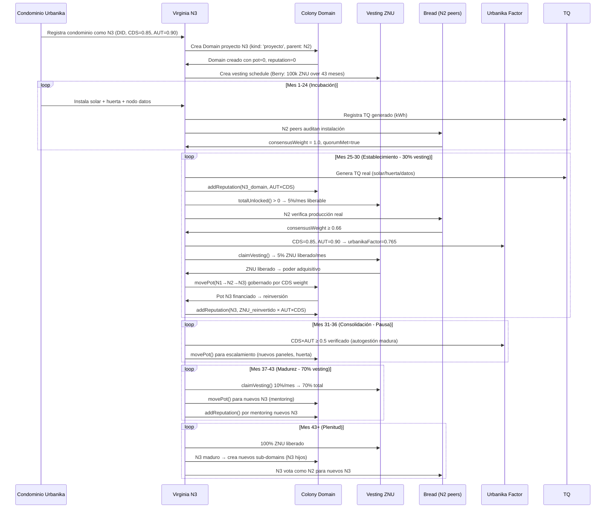

# Integración Completa: Colony + Vesting en Virginia N3 Dinámico + Urbanika + Bread

> **Contexto**: Extensión de `VIRGINIA_N3_DYNAMIC_URBANIKA_BREAD.md` integrando los módulos existentes **Colony** (gobernanza/reputación/pots) y **Vesting** (ZNU por hitos AUT) del repo HSCSG/ALRAC.

---

## 1. Arquitectura Integrada: 5 Capas de Participación

```
┌─────────────────────────────────────────────────────────────────────────────┐
│                    VIRGINIA N3 DINÁMICO — CAPAS DE PARTICIPACIÓN            │
├─────────────────────────────────────────────────────────────────────────────┤
│                                                                             │
│  CAPA 1: MEDICIÓN TERMODINÁMICA (TQ Ledger)                                │
│  ├── N3 genera TQ real (kWh) → anclado RAO                                 │
│  └── TQ_generado_real_kWh = base objetiva                                   │
│                                                                             │
│  CAPA 2: VERIFICACIÓN SOCIAL (Bread)                                       │
│  ├── Pares N2 votan contribución N3                                        │
│  └── consensusWeight = votos_positivos_peso_CDS / total_peso_CDS           │
│                                                                             │
│  CAPA 3: AUTOGESTIÓN VECINAL (Urbanika)                                    │
│  ├── CDS_nodo = cohesión social del bloque                                 │
│  ├── AUT_nodo = autonomía productiva real                                  │
│  └── urbanikaFactor = CDS × AUT (0-1+)                                     │
│                                                                             │
│  CAPA 4: GOBERNANZA PROGRAMABLE (Colony)      ← NUEVO                      │
│  ├── N3 = Domain proyecto en Colony                                        │
│  ├── Reputación = contribución verificada (AUT×CDS)                        │
│  ├── Pot propio = tesorería programable N3                                 │
│  ├── movePot() gobernado por CDS weight                                     │
│  └── Domain tree: N1(root) → N2(sub-domains) → N3(project domains)        │
│                                                                             │
│  CAPA 5: LIBERACIÓN DE VALOR (Vesting ZNU)     ← NUEVO                     │
│  ├── Vesting schedule por hitos AUT (no tiempo)                            │
│  ├── claimVesting() = hito AUT verificado + CDS aprueba                    │
│  ├── ZNU liberado = poder adquisitivo real para N3                         │
│  └── Berry schedule: 30% establecimiento → 70% madurez                     │
│                                                                             │
└─────────────────────────────────────────────────────────────────────────────┘
```

---

## 2. Colony ↔ Virginia Network: Mapeo Estructural

### 2.1 Árbol de Dominios = Estructura Virginia

| Colony Concept | Virginia Network | Función |
|----------------|------------------|---------|
| **Root Domain** (`kind: 'root'`) | **N1 (3 raíces)** | Coordinación estratégica, visión nodal |
| **Sub-domains** (`kind: 'célula'`) | **N2 (9 ramas)** | Puentes coordinación-producción, puentes inter-N3 |
| **Project Domains** (`kind: 'proyecto'`) | **N3 (27 hojas)** | Base productiva verificada, generación TQ real |
| **Fund Domains** (`kind: 'fondo'`) | **Pots N1/N2/N3** | Tesorería programable por nivel |

### 2.2 Reputación Colony = Peso Dinámico N3

```typescript
// src/core/lib/colony.ts — Ya existe: addReputation()
export function addReputation(st: ColonyState, domainId: string, amount: number): ColonyState

// En Virginia N3 Dinámico:
const n3Reputation = getDomainReputation(n3DomainId)  // Ganada por contribución verificada
const n3Weight = (TQ_kWh / TQ_avg) * consensusWeight * urbanikaFactor * (1 + n3Reputation / REP_SCALER)
// Reputación Colony = refuerzo multiplicativo al peso N3
```

### 2.3 Pots Colony = Financiamiento N3

```typescript
// src/core/lib/colony.ts — Ya existe: movePot()
export function movePot(st, fromId, toId, amount, by): ColonyState

// Flujo Virginia N3:
N1_root_pot  →(gobernanza CDS)→  N2_subdomain_pots  →(gobernanza CDS)→  N3_project_pots
     ↑              ↑                    ↑
  15% VTR        20% VTR              30% VTR (Círculo 4 Virginia)

// N3 accede a su pot SOLO si:
// 1. consensusWeight ≥ threshold (Bread verification)
// 2. urbanikaFactor ≥ 0.5 (Urbanika autogestión mínima)
// 3. claimVesting() aprobado (Vesting hito AUT)
```

---

## 3. Vesting ZNU ↔ Virginia N3: Liberación Gradual de Peso/Valor

### 3.1 Vesting Schedule = Progresión de Peso N3

```typescript
// src/core/lib/vesting.ts — Berry Schedule ya existe:
export function buildBerrySchedule(t0: number, allocationZNU: number): VestingTranche[]

// Berry Schedule → Progresión Peso N3:
/*
  MESES 0-24:    Peso N3 = 0 (incubación, sin vesting)
  MESES 25-30:   30% peso liberado (fase establecimiento N3)
                 → 5% por mes × 6 meses = 30%
  MESES 31-36:   PAUSA (consolidación, verificación Bread/Urbanika)
  MESES 37-43:   70% peso liberado (fase madurez productiva)
                 → 10% por mes × 7 meses = 70%
  TOTAL:         100% peso N3 liberado en mes 43
*/
```

### 3.2 claimVesting() = Condición de Acceso a Peso/Valor N3

```typescript
// src/core/lib/vesting.ts — Ya existe: releasable(), totalUnlocked()
export function releasable(schedule, claimed, now): number
export function totalUnlocked(schedule, now): number

// En Virginia N3 Dinámico:
interface N3VestingGateway {
  n3NodeId: string;
  vestingSchedule: VestingTranche[];      // Berry schedule ZNU
  claimedZNU: number;                     // ZNU ya liberado
  
  // Condiciones de unlock (TODAS requeridas):
  canClaimVesting(): boolean {
    return (
      // 1. Hito AUT verificado (TQ real generado)
      this.hasAUTMilestone() &&
      // 2. Verificación Bread (pares N2 aprueban)
      this.peerVerification.consensusWeight >= 0.66 &&
      this.peerVerification.quorumMet &&
      // 3. Autogestión Urbanika mínima
      this.urbanikaFactor.composite >= 0.5 &&
      // 4. Vesting schedule desbloqueado (tiempo + hitos)
      releasable(this.vestingSchedule, this.claimedZNU, Date.now()) > 0
    );
  }
  
  // Al hacer claimVesting():
  async claimVesting(): Promise<ClaimResult> {
    if (!this.canClaimVesting()) throw new Error('Condiciones no cumplidas');
    
    const releasableZNU = releasable(this.vestingSchedule, this.claimedZNU, Date.now());
    this.claimedZNU += releasableZNU;
    
    // EFECTO EN VIRGINIA N3:
    // 1. ZNU liberado → poder adquisitivo real para N3
    // 2. Peso N3 aumenta proporcionalmente (reinversión)
    // 3. Acceso a pot Colony N3 desbloqueado
    // 4. Reputación Colony incrementada (addReputation)
    
    return { znuReleased: releasableZNU, newWeight: this.computeNewWeight() };
  }
}
```

### 3.3 Berry Schedule ↔ Fases de Vida N3

| Fase | Meses | % Vesting | Actividad N3 | Verificación Requerida |
|------|-------|-----------|--------------|------------------------|
| **Incubación** | 0-24 | 0% | Diseño, permisos, capital semilla | Solo planificación |
| **Establecimiento** | 25-30 | 30% (5%/mes) | Instalación solar/huerta/datos, primeras cosechas | Bread: N2 verifica instalación |
| **Consolidación** | 31-36 | 0% (pausa) | Optimización, autogestión Urbanika madura | Urbanika: CDS×AUT ≥ 0.5 |
| **Madurez** | 37-43 | 70% (10%/mes) | Producción plena, reinversión, escalamiento | Bread: consensusWeight ≥ 0.66 |
| **Plenitud** | 43+ | 100% | N3 maduro, mentorea nuevos N3 | Mentoring nuevos N3 |

---

## 4. Flujo Integrado Completo: Condominio Urbanika → N3 Virginia

### Escenario: Condominio 50 viviendas (Urbanika) → N3 Virginia



---

## 5. Tipos Unificados (Extensión tq-types-extended.ts)

```typescript
// src/core/lib/tq-types-extended.ts — ADDITIONS

import type { ColonyState, DomainNode, DomainKind } from '@core/state/colony';
import type { VestingState, VestingTranche } from '@core/state/vesting';

// Colony-Virginia Integration
export interface VirginiaColonyMapping {
  n1RootDomainId: string;           // Colony root domain = N1
  n2SubDomainIds: string[];         // Colony sub-domains = N2 (9)
  n3ProjectDomainIds: string[];     // Colony project domains = N3 (27)
  n3FundDomainIds: string[];        // Colony fund domains = pots N3
  
  // Reputación ↔ Peso N3
  reputationToWeightMultiplier: number;  // default: 0.1 (10% boost per 100 rep)
  minReputationForPotAccess: number;     // default: 50
}

// Vesting-Virginia Integration
export interface VirginiaVestingGateway {
  n3NodeId: string;
  vestingState: VestingState;       // Berry schedule ZNU
  vestingSchedule: VestingTranche[];
  claimedZNU: number;
  
  // Condiciones integradas
  autMilestones: AUTMilestone[];    // Hitos AUT verificados (TQ Ledger)
  peerVerification: PeerVerification; // Bread
  urbanikaFactor: UrbanikaFactor;   // Urbanika CDS×AUT
  
  // Métodos
  canClaimVesting(): boolean;
  claimVesting(): Promise<ClaimResult>;
  computeN3Weight(): number;
}

// Claim Result con efectos Colony + Virginia
export interface ClaimResult {
  znuReleased: number;
  newN3Weight: number;
  colonyReputationGain: number;
  potAccessUnlocked: string[];      // Domain IDs ahora accesibles
  timestamp: number;
}

// AUT Milestone (verificado en TQ Ledger)
export interface AUTMilestone {
  id: string;
  description: string;
  targetTQKwh: number;
  actualTQKwh: number;
  verified: boolean;
  verifiedBy: string[];             // N2 peer DIDs
  verifiedAt: number;
  raoCredentialId: string;
}
```

---

## 5. Motor de Cálculo Unificado (Nuevo Archivo)

```typescript
// src/core/lib/tq-virginia-colony-vesting.ts

import type {
  VirginiaColonyMapping,
  VirginiaVestingGateway,
  VirginiaVestingGateway,
  ClaimResult,
  AUTMilestone,
  PeerVerification,
  UrbanikaFactor,
  N3DynamicWeight
} from './tq-types-extended';
import type { ColonyState, DomainNode } from '@core/state/colony';
import type { VestingState } from '@core/state/vesting';
import { 
  totalUnlocked, 
  releasable, 
  buildBerrySchedule 
} from './vesting';
import { 
  addReputation, 
  movePot, 
  domainChildren 
} from './colony';
import { getTQGeneratedInPeriod } from './tq';

// ============================================================================
// VIRGINIA N3 GATEWAY: Orquesta Colony + Vesting + Bread + Urbanika + TQ
// ============================================================================

export class VirginiaN3Gateway {
  private colonyState: ColonyState;
  private vestingState: VestingState;
  private mapping: VirginiaColonyMapping;
  
  constructor(colonyState: ColonyState, vestingState: VestingState, mapping: VirginiaColonyMapping) {
    this.colonyState = colonyState;
    this.vestingState = vestingState;
    this.mapping = mapping;
  }
  
  // ----------------------------------------------------------------
  // CICLO PRINCIPAL: Periódico (mensual) para cada N3
  // ----------------------------------------------------------------
  
  async processN3Cycle(n3NodeId: string, period: { start: number; end: number }): Promise<N3CycleResult> {
    // 1. Obtener TQ real generado (Capa 1: TQ Ledger)
    const tqGenerated = getTQGeneratedInPeriod(n3NodeId, period);
    
    // 2. Verificar hitos AUT (Capa 1 + 2)
    const autMilestones = await this.verifyAUTMilestones(n3NodeId, tqGenerated);
    
    // 3. Verificación Bread (Capa 2: Pares N2)
    const peerVerification = await this.requestPeerVerification(n3NodeId);
    
    // 4. Factor Urbanika (Capa 3)
    const urbanikaFactor = this.computeUrbanikaFactor(n3NodeId);
    
    // 4. Calcular peso N3 dinámico (síntesis 5 capas)
    const dynamicWeight = this.computeDynamicWeight({
      n3NodeId,
      tqGeneratedKwh: tqGenerated,
      autMilestones,
      peerVerification,
      urbanikaFactor,
      colonyReputation: this.getColonyReputation(n3NodeId),
      vestingState: this.getVestingState(n3NodeId)
    });
    
    // 5. Procesar Vesting si condiciones cumplidas
    const vestingResult = await this.processVesting(n3NodeId, dynamicWeight);
    
    // 6. Actualizar Colony (reputación + pots)
    const colonyUpdates = this.updateColony(n3NodeId, dynamicWeight, vestingResult);
    
    // 6. Calcular nuevo peso N3 para próximo ciclo
    const newWeight = this.computeN3Weight(dynamicWeight, vestingResult);
    
    return {
      n3NodeId,
      period,
      tqGenerated,
      dynamicWeight,
      vestingResult,
      colonyUpdates,
      newWeight,
      timestamp: Date.now()
    };
  }
  
  // ----------------------------------------------------------------
  // VESTING PROCESSING: claimVesting() integrado con Colony
  // ----------------------------------------------------------------
  
  private async processVesting(n3NodeId: string, weight: N3DynamicWeight): Promise<VestingResult> {
    const vestingGateway = this.getVestingGateway(n3NodeId);
    
    if (!vestingGateway.canClaimVesting()) {
      return { claimed: false, reason: 'Conditions not met' };
    }
    
    // Ejecutar claimVesting()
    const claimResult = await vestingGateway.claimVesting();
    
    // Actualizar estado vesting
    this.vestingState = {
      ...this.vestingState,
      claimed: this.vestingState.claimed + claimResult.znuReleased
    };
    
    // EFECTOS COLONY:
    // 1. Incrementar reputación del domain N3
    this.colonyState = addReputation(
      this.colonyState, 
      this.getN3DomainId(n3NodeId), 
      claimResult.colonyReputationGain
    );
    
    // 2. Desbloquear acceso a pot N3 (movePot N2→N3)
    if (claimResult.potAccessUnlocked.length > 0) {
      for (const potId of claimResult.potAccessUnlocked) {
        this.colonyState = movePot(
          this.colonyState,
          this.getN2ParentPotId(n3NodeId),  // from N2 pot
          potId,                             // to N3 pot
          claimResult.znuReleased * ZNU_TO_POT_RATE,
          `vesting-claim-${n3NodeId}`
        );
      }
    }
    
    return {
      znuReleased: claimResult.znuReleased,
      colonyReputationGain: claimResult.colonyReputationGain,
      potAccessUnlocked: claimResult.potAccessUnlocked,
      newWeight: claimResult.newWeight
    };
  }
  
  // ----------------------------------------------------------------
  // CÁLCULO PESO N3 DINÁMICO (5 Capas)
  // ----------------------------------------------------------------
  
  private computeDynamicWeight(input: {
    n3NodeId: string;
    tqGeneratedKwh: number;
    autMilestones: AUTMilestone[];
    peerVerification: PeerVerification;
    urbanikaFactor: UrbanikaFactor;
    colonyReputation: number;
    vestingState: VestingState;
  }): N3DynamicWeight {
    const { tqGeneratedKwh, autMilestones, peerVerification, urbanikaFactor, colonyReputation, vestingState } = input;
    
    // Capa 1: TQ Termodinámico (base objetiva)
    const tqRatio = tqGeneratedKwh / this.getAverageTQPerN3();
    
    // Capa 2: Bread Verification (consenso social)
    const consensusWeight = peerVerification.consensusWeight; // 0-1
    const breadBonus = peerVerification.quorumMet ? 1.0 : 0.5; // Penalización si no quorum
    
    // Capa 3: Urbanika Factor (autogestión vecinal)
    const urbanikaComposite = urbanikaFactor.composite; // CDS × AUT (0-1+)
    
    // Capa 4: Colony Reputation (gobernanza programable)
    const reputationBoost = 1 + (colonyReputation * this.mapping.reputationToWeightMultiplier);
    
    // Capa 5: Vesting Progress (liberación gradual)
    const vestingProgress = totalUnlocked(vestingState.schedule, Date.now()) / 
                           totalAllocation(vestingState.schedule); // 0-1
    const vestingBoost = 0.5 + 0.5 * vestingProgress; // 0.5-1.0
    
    // SÍNTESIS MULTIPLICATIVA
    const rawWeight = tqRatio 
      * consensusWeight 
      * breadBonus 
      * urbanikaComposite 
      * reputationBoost 
      * vestingBoost;
    
    // Normalización global
    const normalizedWeight = rawWeight * ECOSYSTEM_NORMALIZER;
    
    // Suavizado temporal (evitar volatilidad mes a mes)
    const previousWeight = this.getPreviousWeight(input.n3NodeId);
    const smoothedWeight = 0.7 * normalizedWeight + 0.3 * previousWeight;
    
    return {
      nodeId: input.n3NodeId,
      period: { start: Date.now() - 30*DAY, end: Date.now() },
      tqGeneratedKwh,
      tqGeneratedVerified: autMilestones.every(m => m.verified),
      autMilestones,
      peerVerification,
      urbanikaFactor,
      colonyReputation,
      vestingProgress,
      finalWeight: smoothedWeight,
      previousWeight,
      updatedAt: Date.now()
    };
  }
  
  // ----------------------------------------------------------------
  // HELPERS
  // ----------------------------------------------------------------
  
  private async verifyAUTMilestones(n3NodeId: string, tqGenerated: number): Promise<AUTMilestone[]> {
    // Verificar hitos AUT en TQ Ledger + RAO
    const milestones = this.getAUTMilestonesForN3(n3NodeId);
    return milestones.map(m => ({
      ...m,
      actualTQKwh: tqGenerated,
      verified: tqGenerated >= m.targetTQKwh,
      verifiedAt: tqGenerated >= m.targetTQKwh ? Date.now() : 0
    }));
  }
  
  private async requestPeerVerification(n3NodeId: string): Promise<PeerVerification> {
    // Solicitar votación a N2 conectados (Bread protocol)
    const connectedN2 = this.getConnectedN2(n3NodeId);
    const votes = await Promise.all(connectedN2.map(n2 => this.requestVote(n2, n3NodeId)));
    
    const positiveWeight = votes.filter(v => v.vote === 'yes').reduce((s, v) => s + v.weight, 0);
    const totalWeight = votes.reduce((s, v) => s + v.weight, 0);
    
    return {
      votingN2Nodes: connectedN2,
      positiveVotes: votes.filter(v => v.vote === 'yes').length,
      totalVotes: votes.length,
      consensusWeight: totalWeight > 0 ? positiveWeight / totalWeight : 0,
      quorumMet: votes.length >= 3
    };
  }
  
  private computeUrbanikaFactor(n3NodeId: string): UrbanikaFactor {
    const cds = this.getNodeCDS(n3NodeId);      // Cohesión social (Urbanika)
    const aut = this.getNodeAUT(n3NodeId);      // Autonomía productiva (Urbanika)
    return { cds, aut, composite: cds * aut };
  }
  
  private getColonyReputation(n3NodeId: string): number {
    const domainId = this.getN3DomainId(n3NodeId);
    const domain = this.colonyState.domains.find(d => d.id === domainId);
    return domain?.reputation ?? 0;
  }
  
  private getVestingState(n3NodeId: string): VestingState {
    return this.getVestingGateway(n3NodeId).vestingState;
  }
  
  private getVestingGateway(n3NodeId: string): VirginiaVestingGateway {
    // Recuperar o crear gateway para este N3
    return this.vestingGateways.get(n3NodeId) ?? this.createVestingGateway(n3NodeId);
  }
  
  private createVestingGateway(n3NodeId: string): VirginiaVestingGateway {
    const allocationZNU = this.calculateZNUAllocation(n3NodeId);
    const schedule = buildBerrySchedule(Date.now(), allocationZNU);
    
    const gateway: VirginiaVestingGateway = {
      n3NodeId,
      vestingState: { 
        schedule, 
        beneficiary: null, 
        claimed: 0, 
        beneficiarySetDeadline: Date.now() + 365*DAY 
      },
      vestingSchedule: schedule,
      claimedZNU: 0,
      autMilestones: [],
      peerVerification: { votingN2Nodes: [], positiveVotes: 0, totalVotes: 0, consensusWeight: 0, quorumMet: false },
      urbanikaFactor: { cds: 0, aut: 0, composite: 0 },
      
      canClaimVesting: () => {
        const releasableZNU = releasable(schedule, gateway.claimedZNU, Date.now());
        return (
          releasableZNU > 0 &&
          gateway.peerVerification.consensusWeight >= 0.66 &&
          gateway.peerVerification.quorumMet &&
          gateway.urbanikaFactor.composite >= 0.5 &&
          gateway.autMilestones.some(m => m.verified)
        );
      },
      
      claimVesting: async () => {
        const releasableZNU = releasable(schedule, gateway.claimedZNU, Date.now());
        gateway.claimedZNU += releasableZNU;
        
        return {
          znuReleased: releasableZNU,
          newWeight: this.computeN3Weight({...}), // recalcular
          colonyReputationGain: Math.round(releasableZNU * 0.1), // 1 rep per 10 ZNU
          potAccessUnlocked: [this.getN3PotId(n3NodeId)]
        };
      },
      
      computeN3Weight: () => this.computeN3WeightForGateway(gateway)
    };
    
    this.vestingGateways.set(n3NodeId, gateway);
    return gateway;
  }
}

// ============================================================================
// RESULT TYPES
// ============================================================================

interface N3CycleResult {
  n3NodeId: string;
  period: { start: number; end: number };
  tqGenerated: number;
  dynamicWeight: N3DynamicWeight;
  vestingResult: VestingResult;
  colonyUpdates: ColonyUpdates;
  newWeight: number;
  timestamp: number;
}

interface VestingResult {
  claimed: boolean;
  znuReleased: number;
  colonyReputationGain: number;
  potAccessUnlocked: string[];
  newWeight: number;
}

interface ColonyUpdates {
  reputationChanges: Array<{ domainId: string; delta: number }>;
  potTransfers: Array<{ from: string; to: string; amount: number }>;
}
```

---

## 6. Fórmula Unificada de Reparto (Actualizada)

```typescript
// ECOSYSTEM_REVENUE_SHARING.md — Paso 2 actualizado con Colony + Vesting

function computeN3FinalWeight(n3: N3DynamicWeight): number {
  // Base: 5 capas multiplicativas
  const baseWeight = n3.tqRatio 
    * n3.peerVerification.consensusWeight 
    * n3.peerVerification.quorumMet ? 1.0 : 0.5
    * n3.urbanikaFactor.composite
    * (1 + n3.colonyReputation * 0.1)
    * (0.5 + 0.5 * n3.vestingProgress);
  
  // Normalización + suavizado
  return 0.7 * (baseWeight * ECOSYSTEM_NORMALIZER) + 0.3 * n3.previousWeight;
}

// Reparto Círculo 4 (Virginia) con pesos dinámicos:
const CIRCULO_4_DISTRIBUTION = {
  totalVTR: VTR * 0.30,  // 30% para Virginia
  
  N1_weight: (n) => n.cds * n.aut,                    // CDS × AUT real
  N2_weight: (n) => n.cds * n.aut * 1.2,              // +20% puente
  N3_weight: (n) => computeN3FinalWeight(n),           // DINÁMICO (5 capas)
  
  // Distribución intra-N3 por dominio Colony:
  distributeAmongN3: (n3Nodes, vtr) => {
    const totalWeight = n3Nodes.reduce((sum, n) => sum + computeN3FinalWeight(n), 0);
    return n3Nodes.map(n => ({
      nodeId: n.nodeId,
      allocation: vtr * (computeN3FinalWeight(n) / totalWeight),
      vestingUnlock: n.vestingProgress > 0.3 ? 'partial' : n.vestingProgress > 0.8 ? 'full' : 'locked'
    }));
  }
};
```

---

## 7. Spec OpenSpec: `alrac-tq-virginia-colony-vesting.md`

```markdown
# Virginia N3 Dynamic Weight: Colony + Vesting Integration
## openspec/specs/alrac-tq-virginia-colony-vesting.md

## Overview
**Status**: Draft v1.0
**Capa**: 4 (Aplicación) — Virginia Network Recreativo
**Función**: Integración Colony (gobernanza/pots) + Vesting (ZNU hitos AUT) en Virginia N3 Dynamic Weight

## Specs Técnicas

### 1. Colony Integration
- `VirginiaColonyMapping`: N1=root, N2=sub-domains, N3=project domains + fund domains
- Reputación Colony → multiplicador peso N3 (10% per 100 rep)
- Pots Colony → financiación N3 via movePot() gobernado por CDS

### 2. Vesting Integration  
- Berry schedule ZNU (30% meses 25-30, pausa 31-36, 70% meses 37-43)
- claimVesting() = hito AUT + Bread consensus + Urbanika CDS×AUT ≥ 0.5
- ZNU liberado → reputación Colony + pot access + peso N3 boost

### 3. Ciclo Mensual N3
1. TQ Ledger: mide TQ_generado_real_kWh
2. AUT Milestones: verifica hitos en TQ Ledger + RAO
3. Bread: N2 peers votan (consensusWeight, quorum ≥3)
4. Urbanika: CDS×Nodo × AUT×Nodo
4. Colony: reputación → peso boost; movePot() N2→N3
5. Vesting: claimVesting() si todas condiciones → ZNU + reputación + pot access

### 4. Validaciones
- Proactive N3: 43 meses → 100% vesting, peso dinámico estabilizado
- claimVesting() solo si: AUT milestone + Bread consensus ≥0.66 + quorum + Urbanika ≥0.5 + vesting unlocked
- movePot() N2→N3 solo tras claimVesting() aprobado
- Reputación Colony incrementada por ZNU reinvertido × AUT×CDS
```

---

## 8. Conclusión: El Ecosistema Completo

> **Virginia N3 Dinámico = TQ (medición) + Bread (verificación) + Urbanika (autogestión) + Colony (gobernanza/tesorería) + Vesting (liberación gradual)**

| Módulo | Rol en N3 | Efecto en Peso/Valor |
|--------|-----------|---------------------|
| **TQ Ledger** | Medición base | `TQ_kWh` = numerador objetivo |
| **Bread** | Validación social | `consensusWeight` = legitimidad paritaria |
| **Urbanika** | Legitimidad autogestión | `CDS×AUT` = capacidad real de gestionar |
| **Colony** | Gobernanza programable | `reputación` → boost; `pots` → financiamiento |
| **Vesting** | Liberación gradual | `claimVesting()` → ZNU real + reputación + pot access |

**El peso 2.0 "asumido" se convierte en una variable emergente de 5 dimensiones verificables**, donde cada N3 debe:
1. **Generar** (TQ real)
2. **Verificar** (Bread consenso)
3. **Autogestionarse** (Urbanika CDS×AUT)
4. **Gobernar** (Colony reputación/pots)
5. **Liberar valor** (Vesting hitos AUT)

---

## 9. Próximos Pasos Inmediatos

| Acción | Archivo | Prioridad |
|--------|---------|-----------|
| Añadir tipos `VirginiaColonyMapping`, `VirginiaVestingGateway`, `AUTMilestone` | `tq-types-extended.ts` | P0 |
| Crear `VirginiaN3Gateway` class | `tq-virginia-colony-vesting.ts` | P0 |
| Integrar en `ECOSYSTEM_REVENUE_SHARING.md` fórmula actualizada | `docs/ECOSYSTEM_REVENUE_SHARING.md` | P0 |
| Spec OpenSpec completo | `openspec/specs/alrac-tq-virginia-colony-vesting.md` | P1 |
| Pilot: Condominio Urbanika real → N3 con Colony + Vesting | Pilot tracking | P1 |

---

*Integración completa: Colony (gobernanza) + Vesting (liberación) + TQ (medición) + Bread (verificación) + Urbanika (legitimidad) = Virginia N3 verdaderamente dinámico y justo.*