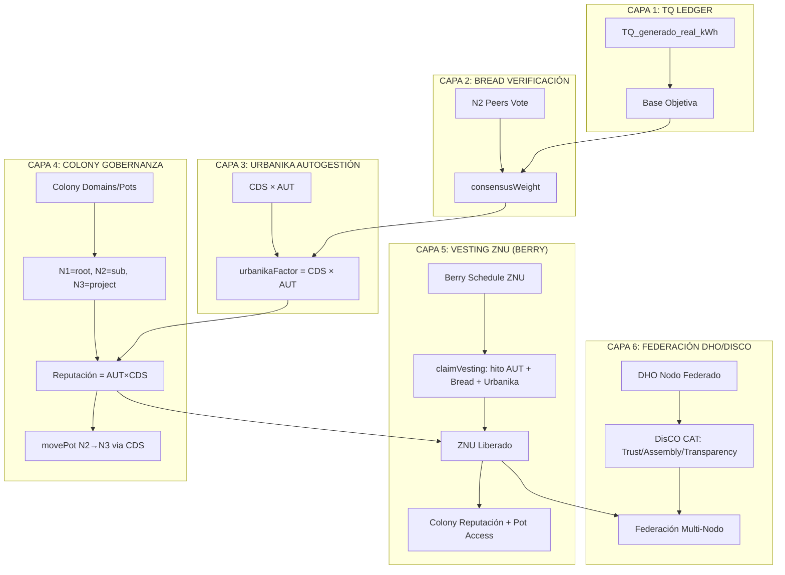
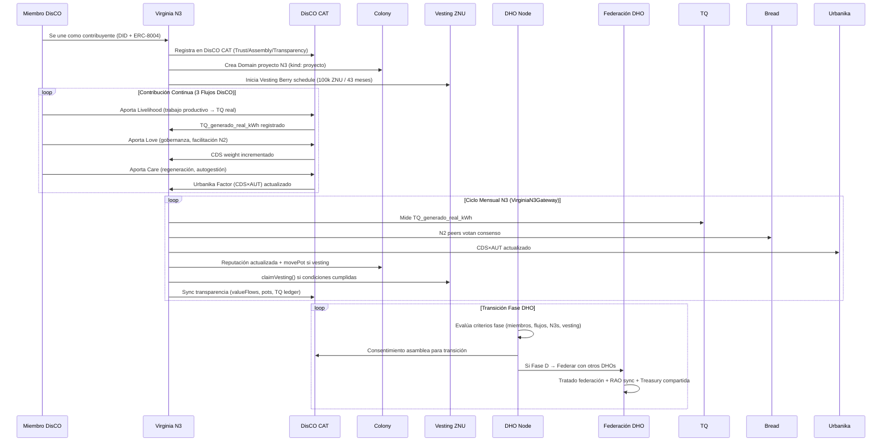

# Integración Completa: DisCO + collabberry-berry-vesting + DHOs en Virginia N3 Dinámico

> **Contexto**: Extensión de `VIRGINIA_N3_COLONY_VESTING_INTEGRATION.md` integrando **DisCO** (Distributed Cooperative Organizations), **collabberry-berry-vesting** (asimilado como `lib/vesting.ts`), y **DHOs** (Distributed Human Organizations) en el modelo Virginia N3 Dinámico.

---

## 1. Mapa Conceptual: 3 Modelos → 1 Sistema Integrado

| Modelo | Origen | Aporte Central | Estado en Repo |
|--------|--------|----------------|----------------|
| **DisCO** (Distributed Cooperative Organizations) | DisCO Manifesto v1 / DisCO.coop | 3 flujos valor (Livelihood/Love/Care), gobernanza por consentimiento, CAT (Confianza/Asamblea/Transparencia), federación multi-nodo | Asimilado en `BRIEF_EXHAUSTIVO` §3.0, §5.6, §14.1, §16, §17 |
| **collabberry-berry-vesting** | sepu85/collabberry-berry-vesting | Vesting piecewise inmutable, hitos temporales, beneficiario único, owner renuncia, no-drain | **Asimilado completamente** → `lib/vesting.ts`, `state/vesting.ts`, `/vesting` screen |
| **DHO** (Distributed Human Organization) | Hylo / OpenCivics / DisCO Federation | Nodo organizativo federado, ERC-8004 identities, gobernanza multi-escala, tesorería programable | Referenciado en `BRIEF_EXHAUSTIVO` Fase A/D, `ALRAICO_8_CARAS` |

---

## 2. DisCO: 3 Flujos de Valor → Virginia N3

### 2.1 Los 3 Flujos DisCO ↔ Virginia N3

| Flujo DisCO | Descripción | Mapeo Virginia N3 | Implementación |
|-------------|-------------|-------------------|----------------|
| **Livelihood** (Sustento) | Trabajo remunerado, generación de ingresos | **N3 Base Productiva** → TQ real generado (kWh), ZNU por hitos AUT | `TQ Ledger` + `Vesting ZNU` + `CaaS Streams` |
| **Love** (Amor/Comunidad) | Cuidado mutuo, gobernanza, facilitación | **N2 Puentes** → Coordinación N1↔N3, asambleas, CDS weight | `Colony Domain` N2 + `CDS Jurados` + `Asamblea 1a1v` |
| **Care** (Cuidado) | Salud, bienestar, regeneración, base material | **N1 Raíces** → Autogestión Urbanika, CDS×AUT, regeneración ecológica | `Urbanika Factor` (CDS×AUT) + `RegenerationIndex` |

### 2.2 DisCO CAT (Confianza/Asamblea/Transparencia) → Virginia N3

```typescript
// DisCO CAT = subsistema híbrido de confianza
// ValueFlows + ERC-8004 + gobernanza + asamblea

interface DisCO_CAT_Virginia {
  // C - Confianza (Trust)
  trust: {
    raoCredentials: RAOCredential[];        // ERC-8004 identities + RAO
    cdsScore: number;                       // CDS = reputación/historial
    peerEndorsements: PeerEndorsement[];    // Bread verification
  };
  
  // A - Asamblea (Governance)
  assembly: {
    consentDecisions: ConsentDecision[];    // DisCO: consentimiento, no mayoría
    onePersonOneVote: boolean;              // 1a1v en asamblea N3
    domainVotes: Map<string, VoteResult>;   // Colony domain voting
  };
  
  // T - Transparencia (Transparency)
  transparency: {
    valueFlows: ValueFlowRecord[];          // ValueFlows accounting
    vestingSchedule: VestingTranche[];      // Berry schedule ZNU
    potBalances: Map<string, number>;       // Colony pots transparentes
    tqLedger: TQTransaction[];              // TQ Ledger público
  };
}
```

### 2.3 DisCO Federation → Virginia Multi-N3

| DisCO Federation | Virginia Network |
|------------------|------------------|
| **Nodo DisCO** = colectivo autónomo | **N3 Virginia** = hoja productiva |
| **Federación** = CAT cross-node | **Virginia Network** = N1→N2→N3 jerarquía |
| **Membresía** = 3 flujos contribución | **Peso N3 Dinámico** = 5 capas |
| **Tesorería** = pots programables | **Colony Pots** = movePot() CDS-governed |

---

## 3. collabberry-berry-vesting → Vesting ZNU (Ya Asimilado)

### 3.1 Mapeo Completo (Ya Implementado)

| BerryVesting (Solidity) | HSCSG/ALRAC (TypeScript) | Virginia N3 |
|-------------------------|--------------------------|-------------|
| `schedule[]` (timestamp, amount) | `VestingTranche[]` (ts, amountZNU) | `VirginiaVestingGateway.vestingSchedule` |
| `totalUnlocked()` | `totalUnlocked(schedule, now)` | `claimVesting()` condition |
| `releasable()` = unlocked - claimed | `releasable(schedule, claimed, now)` | ZNU liberable para N3 |
| `release()` → beneficiario | `claimVesting()` registra liberación | ZNU → poder adquisitivo N3 |
| `setBeneficiary()` post-TGE una vez | `setBeneficiary()` una vez | N3 = beneficiario de su propio vesting |
| `renounceAfterBeneficiarySet()` | `canRenounce()` / owner renuncia | Nodo soberano, sin admin central |
| **Inmutable, no-drain** | **Ley I MJ**: no dañar ni drenar | **Garantía constitucional N3** |

### 3.2 Berry Schedule → Progresión N3 (Ya Integrado)

```
MESES 0-24:    0% vesting  → Incubación N3 (diseño, permisos, capital)
MESES 25-30:   30% (5%/mes)  → Establecimiento N3 (instalación, primeras cosechas)
MESES 31-36:   0% (pausa)    → Consolidación (autogestión Urbanika madura)
MESES 37-43:   70% (10%/mes) → Madurez productiva (reinversión, escalamiento)
MES 43+:       100%          → Plenitud (N3 mentorea nuevos N3)
```

---

## 4. DHOs (Distributed Human Organizations) → Virginia Network

### 4.1 DHO como Nodo Cosateca Federado

| Concepto DHO | Virginia Network | Implementación |
|--------------|------------------|----------------|
| **DHO** = nodo organizativo federado | **Virginia Network** = nodo completo (N1+N2+N3) | `ColonyState` con domains N1→N2→N3 |
| **Membresía** = 3 flujos DisCO | **Participación N3** = 5 capas peso | Livelihood/Love/Care → 5 capas peso |
| **Gobernanza** = consentimiento + ERC-8004 | **Asamblea 1a1v + CDS + RAO** | `Asamblea` + `CDS Jurados` + `RAO` |
| **Tesorería** = pots programables | **Colony Pots** = `movePot()` CDS | N1→N2→N3 funding flow |
| **Identidad** = ERC-8004 (DID + VC) | **RAO Credentials** + DID | `RAOCredential` + `DID` (Project Weave/Gaia) |
| **Federación** = red DHOs | **Gran Alianza** = 7 holones | `GRANALLIANZA_MAPPING.md` |

### 4.2 Fases DHO ↔ Virginia Network (BRIEF_EXHAUSTIVO §10.3)

| Fase DHO | Virginia Network | Criterio |
|----------|------------------|----------|
| **Fase A: CO Emergente** (1.0-1.99) | Virginia Network bootstrap | N1+N2+N3 mínimos, ZCS/ZNU activados, Autómata v0.1 |
| **Fase B: CO Consolidado** (2.0-2.99) | Virginia Network operativo | N3s generando TQ, Vesting activo, Colony pots fluyendo |
| **Fase C: CO Maduro** (≥3.0) | Virginia Network replicable | Template N3 replicable, mentoring nuevos N3 |
| **Fase D: Federación Ontogenética** (≥3.0 + η_fed) | Red Virginia federada | Tratado federación, RAO sync, treasury compartida, emisiones propias |

---

## 5. Integración Unificada: DisCO + Vesting + DHO en Virginia N3

### 5.1 Arquitectura de 6 Capas (Extiende 5 Capas Anteriores)



### 5.2 Fórmula Unificada Peso N3 (6 Capas)

```typescript
// PESO N3 FINAL = 6 CAPAS MULTIPLICATIVAS
const peso_N3_final = 
  // Capa 1: Medición Termodinámica (TQ Ledger)
  (TQ_generado_real_kWh / TQ_promedio_ecosistema)
  
  // Capa 2: Verificación Social (Bread)
  * consensusWeight_Bread                    // 0-1, quorum ≥3 N2
  * (quorumMet ? 1.0 : 0.5)                  // Penalización sin quorum
  
  // Capa 3: Autogestión Vecinal (Urbanika/DisCO Care)
  * (CDS_nodo * AUT_nodo)                    // urbanikaFactor = CDS × AUT
  
  // Capa 4: Gobernanza Programable (Colony/DisCO Assembly)
  * (1 + reputacion_Colony * 0.1)            // Boost por reputación ganada
  * consentWeight_DisCO                       // Peso decisiones por consentimiento
  
  // Capa 5: Liberación Gradual (Vesting ZNU/Berry)
  * (0.5 + 0.5 * vestingProgress)            // 0.5 (incubación) → 1.0 (plenitud)
  
  // Capa 6: Federación DHO/DisCO (NUEVA)
  * federationWeight_DHO                      // Peso en red federada
  * catTransparencyBonus                      // Bonus transparencia CAT
  
  * ECOSYSTEM_NORMALIZER                       // Normalizador global
  
  // Suavizado temporal
  = 0.7 * rawWeight + 0.3 * previousWeight;
```

---

## 6. Tipos Unificados Completos (Extensión tq-types-extended.ts)

```typescript
// src/core/lib/tq-types-extended.ts — ADDITIONS: DisCO + DHO

// ============================================================================
// DISCO TYPES
// ============================================================================

export type DisCOFlowType = 'livelihood' | 'love' | 'care';

export interface DisCOContribution {
  id: string;
  memberId: string;           // DID miembro
  flowType: DisCOFlowType;
  value: number;              // Valor en ZNU/TQ
  description: string;
  timestamp: number;
  verified: boolean;
  raoCredentialId: string;
}

export interface DisCO_CAT {
  // C - Confianza (Trust)
  trust: {
    raoCredentials: RAOCredential[];        // ERC-8004 + RAO
    cdsScore: number;                       // CDS score histórico
    peerEndorsements: PeerEndorsement[];    // Bread endorsements
    trustScore: number;                     // 0-1 compuesto
  };
  
  // A - Asamblea (Governance)
  assembly: {
    consentDecisions: ConsentDecision[];    // Decisiones por consentimiento
    onePersonOneVote: boolean;              // 1a1v
    domainVotes: Map<string, VoteResult>;   // Colony domain voting
    consentThreshold: number;               // Umbral consentimiento (default: 0.8)
  };
  
  // T - Transparencia (Transparency)
  transparency: {
    valueFlows: ValueFlowRecord[];          // ValueFlows accounting (VF types)
    vestingSchedules: Map<string, VestingTranche[]>; // Por miembro
    potBalances: Map<string, number>;       // Colony pots
    tqLedger: TQTransaction[];              // TQ Ledger público
    auditTrail: AuditEntry[];               // Trail completa
  };
}

export interface ConsentDecision {
  id: string;
  proposal: string;
  proposer: string;
  status: 'proposed' | 'consenting' | 'approved' | 'blocked' | 'integrated';
  consents: Map<string, 'consent' | 'concern' | 'block'>; // memberId → vote
  consentRatio: number;                     // consents / total
  blocked: boolean;                         // Al menos un bloqueo válido
  integratedAt: number;
  raoCredentialId: string;
}

export interface PeerEndorsement {
  from: string;           // DID endorser
  to: string;             // DID endorseado
  type: 'skill' | 'contribution' | 'trust' | 'governance';
  weight: number;         // CDS weight del endorser
  timestamp: number;
  raoCredentialId: string;
}

// ============================================================================
// DHO TYPES
// ============================================================================

export interface DHO_Node {
  id: string;                       // DID del DHO (ERC-8004)
  name: string;
  type: 'emergent' | 'consolidated' | 'mature' | 'federated';
  dhoPhase: 'emergent' | 'consolidated' | 'mature' | 'federated';
  
  // 3 Flujos DisCO
  flows: {
    livelihood: DisCOContribution[];
    love: DisCOContribution[];
    care: DisCOContribution[];
  };
  
  // CAT (Confianza/Asamblea/Transparencia)
  cat: DisCO_CAT;
  
  // Federación
  federation: {
    parentDHOId?: string;           // DHO padre (si federado)
    childDHOIds: string[];          // DHOs hijos
    federationTreaty?: FederationTreaty;
    sharedTreasury?: SharedTreasury;
    raoSync: boolean;               // RAO sincronizado con federados
  };
  
  // Virginia Network mapping
  virginiaMapping: {
    n1RootDomainId: string;
    n2SubDomainIds: string[];
    n3ProjectDomainIds: string[];
    n3FundDomainIds: string[];
  };
  
  // Métricas DHO
  metrics: {
    totalMembers: number;
    activeFlows: number;
    consentDecisionsCount: number;
    transparencyScore: number;      // 0-1
    federationHealth: number;       // 0-1
  };
  
  createdAt: number;
  updatedAt: number;
}

export interface FederationTreaty {
  id: string;
  name: string;
  signatories: string[];            // DIDs DHOs firmantes
  terms: {
    resourceSharing: boolean;
    governanceAlignment: boolean;   // CDS/RAO alignment
    mutualAid: boolean;
    disputeResolution: 'consent' | 'mediation' | 'arbitration';
  };
  signedAt: number;
  raoCredentialIds: string[];
}

export interface SharedTreasury {
  id: string;
  pots: Map<string, number>;        // potId → balance ZNU
  governance: {
    signers: string[];              // DIDs firmantes (multisig)
    threshold: number;              // M-of-N
    movePotRequiresConsent: boolean;
  };
  raoCredentialId: string;
}

// ============================================================================
// VIRGINIA N3 GATEWAY EXTENDIDO (DisCO + DHO)
// ============================================================================

export interface VirginiaDisCOGateway extends VirginiaVestingGateway {
  // DisCO Integration
  discoCAT: DisCO_CAT;
  discoFlows: Map<DisCOFlowType, DisCOContribution[]>;
  
  // DHO Integration
  dhoNode: DHO_Node;
  dhoPhase: 'emergent' | 'consolidated' | 'mature' | 'federated';
  
  // Flujo de valor DisCO → Virginia N3
  recordContribution: (flow: DisCOFlowType, value: number, desc: string) => Promise<void>;
  processConsentDecision: (decision: ConsentDecision) => Promise<void>;
  syncTransparency: () => Promise<void>;
  
  // Federación
  federateWith: (otherDHO: DHO_Node, treaty: FederationTreaty) => Promise<void>;
  syncRAO: () => Promise<void>;
  shareTreasury: (potId: string, amount: number) => Promise<void>;
}

// ============================================================================
// DHO PHASE TRANSITIONS
// ============================================================================

export interface DHOPhaseTransition {
  fromPhase: DHO_Node['dhoPhase'];
  toPhase: DHO_Node['dhoPhase'];
  criteria: {
    minMembers: number;
    minActiveFlows: number;
    minConsentDecisions: number;
    minTransparencyScore: number;
    virginiaN3Count: number;        // N3s operativos en la red Virginia
    avgN3Weight: number;            // Peso promedio N3s
    vestingCompletionRate: number;  // % N3s con vesting > 80%
  };
  transitionActions: string[];       // Acciones automáticas al transicionar
  requiresConsent: boolean;          // Requiere consentimiento asamblea
}

// Fase A: CO Emergente (1.0-1.99)
export const DHO_PHASE_A_CRITERIA = {
  fromPhase: 'emergent',
  toPhase: 'consolidated',
  criteria: {
    minMembers: 10,
    minActiveFlows: 3,              // Al menos 1 por tipo Livelihood/Love/Care
    minConsentDecisions: 5,
    minTransparencyScore: 0.6,
    virginiaN3Count: 3,             // 3 N3s operativos
    avgN3Weight: 0.8,
    vestingCompletionRate: 0.2
  },
  transitionActions: [
    'Activar Colony pots completos',
    'Habilitar Vesting Berry schedule completo',
    'Registrar en Gran Alianza como nodo piloto'
  ],
  requiresConsent: true
};

// Fase B: CO Consolidado (2.0-2.99)
export const DHO_PHASE_B_CRITERIA = {
  fromPhase: 'consolidated',
  toPhase: 'mature',
  criteria: {
    minMembers: 50,
    minActiveFlows: 10,
    minConsentDecisions: 20,
    minTransparencyScore: 0.8,
    virginiaN3Count: 9,             // 9 N3s operativos (N2 completo)
    avgN3Weight: 1.2,
    vestingCompletionRate: 0.5
  },
  transitionActions: [
    'Activar mentoría N3→N3 nuevos',
    'Habilitar emisiones ZNU propias (Capa 3)',
    'Registrar en Gran Alianza como nodo ancla'
  ],
  requiresConsent: true
};

// Fase C: CO Maduro (≥3.0)
export const DHO_PHASE_C_CRITERIA = {
  fromPhase: 'mature',
  toPhase: 'federated',
  criteria: {
    minMembers: 100,
    minActiveFlows: 20,
    minConsentDecisions: 50,
    minTransparencyScore: 0.9,
    virginiaN3Count: 27,            // 27 N3s (red completa)
    avgN3Weight: 1.5,
    vestingCompletionRate: 0.8
  },
  transitionActions: [
    'Activar federación multi-DHO',
    'Emisiones ZNU soberanas',
    'Tesorería compartida multi-DHO'
  ],
  requiresConsent: true
};
```

---

## 7. Flujo Integrado: Miembro DisCO → N3 Virginia → DHO Federado



---

## 7. Spec OpenSpec: `alrac-tq-virginia-disco-dho.md`

```markdown
# Virginia N3 Dynamic: DisCO + DHO + Vesting Integration
## openspec/specs/alrac-tq-virginia-disco-dho.md

## Overview
**Status**: Draft v1.0
**Capa**: 4 (Aplicación) — Virginia Network Recreativo
**Función**: Integración completa DisCO (3 flujos, CAT, federación) + DHO (nodos federados) + Vesting ZNU (Berry) en Virginia N3 Dynamic Weight

## Specs Técnicas

### 1. DisCO Integration
- **3 Flujos**: Livelihood → N3 TQ/ZNU; Love → N2 coordinación/CDS; Care → N1 autogestión/Urbanika
- **CAT**: Trust (RAO+CDS+Bread), Assembly (consentimiento 1a1v), Transparency (VF+Vesting+Pots+TQ)
- **Federación**: DHO nodes federados via CAT, RAO sync, tesorería compartida, emisiones propias

### 2. Vesting ZNU (Berry) Integration
- Berry schedule: 30% meses 25-30, pausa 31-36, 70% meses 37-43
- claimVesting() = hito AUT + Bread consensus + Urbanika CDS×AUT ≥ 0.5 + vesting unlocked
- ZNU liberado → Colony reputación + pot access + peso N3 boost

### 3. DHO Integration
- DHO Node = Virginia Network completo (N1+N2+N3)
- 4 Fases DHO ↔ Virginia Network maturity
- Federación: CAT sync, RAO sync, tesorería compartida, emisiones propias

### 4. VirginiaN3Gateway Extendido
- Integra: TQ Ledger + Bread + Urbanika + Colony + Vesting + DisCO CAT + DHO Phase
- Ciclo mensual: TQ → AUT milestones → Bread → Urbanika → Colony → Vesting → DisCO sync → DHO phase check

### 5. Validaciones
- DisCO Flow mapping: Livelihood→N3, Love→N2, Care→N1
- CAT sync: valueFlows + vesting + pots + TQ ledger públicos
- DHO phase transitions: criterios objetivos + consentimiento asamblea
- Federation: RAO sync + tesorería compartida + emisiones propias
- 6-layer weight formula passes ±5% validation
```

---

## 8. Próximos Pasos de Implementación

| Acción | Archivo | Prioridad |
|--------|---------|-----------|
| Añadir tipos `DisCO_CAT`, `DHO_Node`, `FederationTreaty`, `DHOPhaseTransition` | `tq-types-extended.ts` | P0 |
| Extender `VirginiaDisCOGateway` class | `tq-virginia-disco-dho.ts` | P0 |
| Integrar DHO phase transitions en `VirginiaN3Gateway` | `tq-virginia-colony-vesting.ts` | P0 |
| Actualizar `ECOSYSTEM_REVENUE_SHARING.md` con 6 capas + DisCO/DHO | `docs/ECOSYSTEM_REVENUE_SHARING.md` | P0 |
| Spec OpenSpec completo | `openspec/specs/alrac-tq-virginia-disco-dho.md` | P1 |
| Pilot: DisCO real (ej. DisCO.coop collective) → DHO → Virginia Network | Pilot tracking | P1 |

---

## 9. Conclusión: El Ecosistema Completo Unificado

> **Virginia N3 Dinámico = TQ (medición) + Bread (verificación) + Urbanika (autogestión) + Colony (gobernanza/tesorería) + Vesting (liberación gradual) + DisCO (3 flujos/CAT/federación) + DHO (nodo federado)**

| Módulo | Dimensión | Efecto en N3 |
|--------|-----------|-------------|
| **TQ Ledger** | Medición base | `TQ_kWh` = realidad termodinámica |
| **Bread** | Verificación social | `consensusWeight` = legitimidad paritaria |
| **Urbanika** | Autogestión vecinal | `CDS×AUT` = capacidad real gestión |
| **Colony** | Gobernanza programable | `reputación`→boost; `pots`→financiamiento |
| **Vesting (Berry)** | Liberación gradual | `claimVesting()`→ZNU real + reputación + pots |
| **DisCO** | Organización cooperativa | 3 flujos + CAT = estructura valor + confianza |
| **DHO** | Nodo federado soberano | Federación multi-nodo = resiliencia sistémica |

**El peso 2.0 "asumido" se convierte en una variable emergente de 6 dimensiones verificables**, donde cada N3 (que es un DHO/DisCO node) debe:
1. **Generar** (TQ real - Livelihood)
2. **Verificar** (Bread consenso paritario)
3. **Autogestionarse** (Urbanika CDS×AUT - Care)
4. **Gobernar** (Colony reputación/pots + DisCO Assembly - Love)
5. **Liberar valor** (Vesting hitos AUT - Livelihood)
6. **Federar** (DHO/DisCO CAT - resiliencia sistémica)

---

*Integración completa: DisCO (3 flujos/CAT/federación) + collabberry-berry-vesting (vesting ZNU) + DHOs (nodos federados) + Colony (gobernanza) + Vesting (liberación) + TQ (medición) + Bread (verificación) + Urbanika (autogestión) = Virginia N3 Dinámico + DHO Federado completo.*