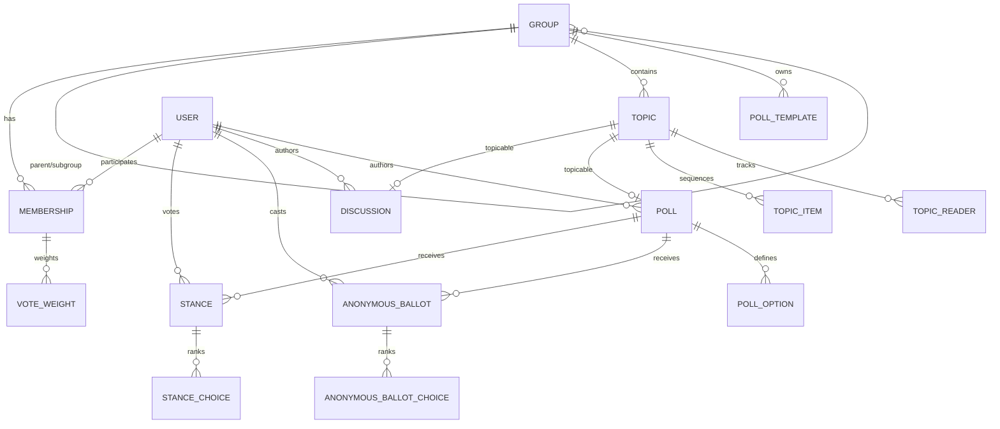

# Loomio - Integración Arquitectónica HSCSG ARM

## Resumen Ejecutivo

Loomio es una **plataforma de decisión colaborativa** open-source (AGPL-3.0) usada por cooperativas, ONGs, juntas directivas, sindicatos y equipos distribuidos. Su valor único para HSCSG radica en:

1. **Motor de Decisiones Polimórfico**: 11 tipos de poll/decision con voting rules configurables
2. **Algoritmo STV Completo**: Single Transferable Vote (Scottish + Meek) validado contra elecciones oficiales
3. **Modelo de Gobernanza Granular**: Permisos por recurso, jerarquía de grupos, pesos de voto
4. **Privacidad por Diseño**: Ballots anónimos, hide results until closed, stance reasons
5. **Edición Colaborativa Real-time**: Yjs/Automerge con auth token-based

## Análisis de 5 Capas (ARM Architecture)

### Capa 1: Domain Model (Domain Entities)



**Entidades Core para ARM**:

| Entidad ARM | Loomio Source | Adaptación HSCSG |
|-------------|---------------|------------------|
| `Affiliate` | `User` + `Membership` | Profile + roles + trust score + karma |
| `Project` | `Group` | Jerarquía, privacy settings, subscription limits |
| `Investigation` | `Discussion` | Thread con context, tags, attachments |
| `Proposal` | `Poll` | 11 tipos → ProposalType enum; STV, weighted, anonymous |
| `Vote` | `Stance` | Position con choices, scores, weight, reason |
| `AnonymousVote` | `AnonymousBallot` | Ballot criptográfico separado de identidad |
| `Thread` | `Topic` | Contenedor polimórfico, sequence IDs, locking |
| `ProposalTemplate` | `PollTemplate` | Config-driven templates por ProposalType |

### Capa 2: Operations (Single Write Path)

**Loomio Operations** (extraídos de controllers/services):

| Operación Loomio | ARM Operation | Invariant |
|------------------|---------------|-----------|
| `DiscussionsController#create` | `CreateInvestigation` | Author must be member |
| `PollsController#create` | `CreateProposal` | Valid ProposalType, author in group |
| `StancesController#create` | `CastVote` | Poll open, voter eligible, valid choices |
| `AnonymousBallotsController#create` | `CastAnonymousVote` | Poll anonymous, valid ballot |
| `MembershipsController#create` | `JoinProject` | Invitation valid, group enabled |
| `GroupsController#create` | `CreateProject` | Creator becomes admin |
| `TopicItemsController#update` | `UpdateThreadSequence` | Lock ordering, atomic counts |
| `PollTemplatesController#create` | `CreateProposalTemplate` | Valid type, group permission |

**ARM Invariants Aplicados**:
1. **One Write Path**: Todas las mutaciones via `arm-core/src/ops.ts` operations
2. **Everything Shows Source**: `author_id`, `inviter_id`, `poll_type` trazados
3. **Nothing Lands Unapproved**: `ReviewGate` para proposals, memberships, templates
4. **Your Data Your Rules**: `GroupPrivacy` settings → ARM `DataSovereignty` config

### Capa 3: Memory/State (Event Sourcing + Projections)

**Loomio State Patterns**:
- `has_paper_trail` en todas las entidades core (version history)
- `TopicItem` sequence IDs con `RangeSet` para ordering eficiente
- `RecordCounts` denormalizado para performance (memberships_count, polls_count, etc.)
- `TopicReader` para read receipts y delivery volumes
- `WeightHistory` separado de PaperTrail para vote weights

**ARM Adaptation**:
```typescript
// arm-core/src/lib/loomioState.ts
interface LoomioEvent {
  type: 'investigation.created' | 'proposal.created' | 'vote.cast' | 'vote.weight.changed' | 'member.joined' | 'member.left' | 'proposal.closed' | 'proposal.outcome.recorded';
  aggregateId: string;
  payload: Record<string, unknown>;
  metadata: { authorId: string; timestamp: number; source: 'user' | 'agent' | 'system'; };
}

interface LoomioProjection {
  investigation: InvestigationView;
  proposal: ProposalView;
  voteTally: VoteTallyView;
  memberRegistry: MemberRegistryView;
  threadSequence: ThreadSequenceView;
}
```

### Capa 4: Patterns → Signals (Detection Engine)

**Patrones Loomio Detectados**:

| Patrón | Detección | Señal ARM | Acción |
|--------|-----------|-----------|--------|
| **Propuesta estancada** | Poll abierto > X días sin votos | `proposal.stalled` | Recordatorio automático, escalation |
| **Consenso emergente** | >80% agree en proposal tipo consensus | `consensus.emerging` | Notificar, sugerir outcome |
| **Bloqueo persistente** | Múltiples blocks en consensus | `block.persistent` | Mediación sugerida, facilitation |
| **Participación baja** | < quorum en propuesta activa | `participation.low` | Invitar stakeholders, extender deadline |
| **Peso de voto concentrado** | Top 20% miembros tienen >80% peso | `weight.concentrated` | Revisar distribución de pesos |
| **Subgrupos aislados** | Subgroups sin cross-participation | `subgroup.isolated` | Sugerir integración, shared proposals |
| **Templates no usados** | Poll templates creados pero nunca usados | `template.unused` | Archive, sugerir mejores prácticas |
| **Ballots anónimos vs identificados** | Ratio anonymous/identified anómalo | `anonymity.anomaly` | Auditoría de privacidad |
| **STV multi-round** | STV requiere >3 rondas | `stv.complex` | Logging detallado, explicabilidad |
| **Outcome sin razón** | Propuesta cerrada sin outcome recorded | `outcome.missing` | Requerir outcome, tracking |

### Capa 5: Agent-Human Loop (Review Gates)

**Loomio Gates Existentes**:
1. **Membership Approval** - Admin approval para join requests
2. **Poll Creation Permission** - `members_can_raise_motions` setting
3. **Template Review** - Member templates auto-discarded, admin unhide
4. **Outcome Recording** - Solo thread admins pueden agregar outcome
5. **Lock/Unlock** - Thread locking archiva, solo admins unlock
6. **Anonymous Ballot Config Freeze** - Config inmutable tras primer ballot

**ARM Review Gates** (extendiendo `arm-core/src/agentHuman.ts`):

```typescript
// arm-loomio/src/agentHuman.ts
enum LoomioReviewGate {
  PROPOSAL_CREATION = 'proposal.creation',           // members_can_raise_motions
  PROPOSAL_CLOSURE = 'proposal.closure',             // quorum, timeline
  OUTCOME_RECORDING = 'outcome.recording',           // thread admin only
  MEMBERSHIP_APPROVAL = 'membership.approval',       // admin approval
  TEMPLATE_PUBLICATION = 'template.publication',     // admin review
  WEIGHT_ASSIGNMENT = 'weight.assignment',           // validation + audit
  ANONYMITY_CONFIG = 'anonymity.config',             // freeze after ballot
  STV_PARAMETERS = 'stv.parameters',                 // seats, method, quota validation
  THREAD_LOCK = 'thread.lock',                       // archive notification
  LEGAL_ACCEPTANCE = 'legal.acceptance',             // terms tracking
}
```

---

## Integración con Paquetes ARM Existentes

### 1. `arm-core` - Shared Kernel

**Nuevos módulos en `arm-core/src/lib/`**:
```
arm-core/src/lib/
├── loomio/
│   ├── proposalTypes.ts          # 11 ProposalType definitions + config
│   ├── stv.ts                    # STV Algorithm (Scottish + Meek) - PORTED
│   ├── voteWeights.ts            # Weight validation, rounding, audit
│   ├── anonymousVoting.ts        # Ballot crypto separation
│   ├── threadSequence.ts         # RangeSet for topic ordering
│   ├── groupHierarchy.ts         # Parent/subgroup permissions inheritance
│   ├── notificationRouting.ts    # Email/Push/In-app volume prefs
│   └── legalAcceptance.ts        # Terms acceptance tracking
├── valueDual.ts                  # EXISTING - amphibious monetary
└── brand.ts                      # EXISTING - ARM brand registry
```

**ProposalType System** (portado de `config/poll_types.yml`):
```typescript
// arm-core/src/lib/loomio/proposalTypes.ts
enum ProposalType {
  PROPOSAL = 'proposal',       // Decisión formal agree/disagree/block
  CHECK = 'check',             // Verificación rápida
  ADVICE = 'advice',           // Request for comments
  CONSENT = 'consent',         // Sociocracy - no objection
  CONSENSUS = 'consensus',     // Consenso graduado
  POLL = 'poll',               // Múltiples opciones
  SCORE = 'score',             // Puntuación numérica
  DOT_VOTE = 'dot_vote',       // Distribución puntos limitados
  RANKED_CHOICE = 'ranked_choice', // Preferencias ordenadas (IRV)
  STV = 'stv',                 // Single Transferable Vote
  MEETING = 'meeting',         // Programación reuniones
}

interface ProposalTypeConfig {
  key: ProposalType;
  label: string;
  description: string;
  votingMethod: 'majority' | 'consensus' | 'consent' | 'plurality' | 'scoring' | 'dot_voting' | 'irv' | 'stv' | 'scheduling';
  defaults: {
    durationDays?: number;
    choiceCountMin?: number;
    choiceCountMax?: number;
    hideResults?: 'never' | 'until_closed' | 'always';
    stanceReasonRequired?: 'disabled' | 'required' | 'required_for_disagree_or_block' | 'required_for_block';
    preventAnonymous?: boolean;
    preventWeightedVoting?: boolean;
    // STV specific
    stvSeats?: number;
    stvMethod?: 'scottish' | 'meek';
    stvQuota?: 'droop' | 'hare';
    // Score specific
    scoreMin?: number;
    scoreMax?: number;
    // Dot vote specific
    pointsPerVoter?: number;
  };
  constraints: {
    requiresOptions: boolean;
    minOptions?: number;
    maxOptions?: number;
    supportsWeightedVoting: boolean;
    supportsAnonymous: boolean;
    supportsStv: boolean;
  };
}
```

### 2. `arm-sensorica` - Governance Extension

**Extensiones en `arm-sensorica/src/core/governance/`**:
```typescript
// arm-sensorica/src/core/governance/loomioProposal.ts
interface LoomioProposal extends Proposal {
  type: ProposalType;
  config: ProposalTypeConfig;
  anonymous: boolean;
  hideResults: 'never' | 'until_closed' | 'always';
  stanceReasonRequired: StanceReasonRequired;
  weightedVoting: boolean;
  voteWeights: Map<string, number>; // affiliateId -> weight (3 decimals)
  // STV specific
  stvSeats?: number;
  stvMethod?: 'scottish' | 'meek';
  stvQuota?: 'droop' | 'hare';
  // Score specific
  scoreMin?: number;
  scoreMax?: number;
  // Dot vote specific
  pointsPerVoter?: number;
  // Meeting specific
  meetingDuration?: number;
  timeZone?: string;
  canRespondMaybe?: boolean;
}

// Extender GovernanceService
class LoomioGovernanceService extends GovernanceService {
  async createProposal(input: CreateLoomioProposalInput): Promise<Proposal> { ... }
  async castVote(input: CastVoteInput): Promise<Vote> { ... }
  async castAnonymousVote(input: CastAnonymousVoteInput): Promise<AnonymousVote> { ... }
  async countSTV(proposalId: string): Promise<STVResult> { ... }
  async countScore(proposalId: string): Promise<ScoreResult> { ... }
  async countDotVote(proposalId: string): Promise<DotVoteResult> { ... }
  async countRankedChoice(proposalId: string): Promise<RankedChoiceResult> { ... }
  async validateVoteWeights(affiliateIds: string[]): Promise<ValidationResult> { ... }
}
```

### 3. `arm-gratiferia` - Decision Rewards

**Integración con Karma System**:
```typescript
// arm-gratiferia/src/core/karma.ts (extendido)
interface DecisionKarmaRules {
  proposalCreated: number;        // +10 karma
  voteCast: number;               // +5 karma
  voteWithReason: number;         // +10 karma (reason > 50 chars)
  consensusReached: number;       // +25 karma all participants
  proposalClosedWithOutcome: number; // +15 karma author
  templateCreated: number;        // +20 karma
  templateUsed: number;           // +5 karma creator
  facilitation: number;           // +15 karma mediator
  stvParticipation: number;       // +10 karma (complexity bonus)
}
```

### 4. `arm-cli` - Decision Workflows

**Comandos nuevos en `arm-loomio/cli/src/index.ts`**:
```bash
# Proposals
arm decision propose --type=consensus --group=coop --title="Budget 2027" --duration=14
arm decision propose --type=stv --seats=3 --method=scottish --quota=droop
arm decision propose --type=dot_vote --points=100 --options="A,B,C,D"

# Voting
arm decision vote --proposal=abc123 --choice=agree --reason="Aligns with values"
arm decision vote --proposal=abc123 --anonymous --ranked="1:A,2:B,3:C"
arm decision vote --proposal=abc123 --score="A:8,B:5,C:3"

# Templates
arm decision template create --type=proposal --name="Standard Proposal" --group=coop
arm decision template list --group=coop

# Results
arm decision result --proposal=abc123 --format=json
arm decision result --proposal=abc123 --explain-stv

# Group management
arm decision group create --name="New Working Group" --parent=coop --visibility=private
arm decision group invite --group=coop --user=alice --role=member
arm decision group weights --group=coop --set="alice:1.5,bob:0.8"
```

### 5. `arm-mcp` - AI-Assisted Decisions

**Tools MCP en `arm-loomio/mcp/src/index.ts`**:
```typescript
const loomioMCPTools = [
  // Proposal creation assistance
  { name: 'create_proposal', description: 'Create a new decision proposal with guided type selection', ... },
  { name: 'suggest_proposal_type', description: 'Analyze context and suggest best proposal type', ... },
  { name: 'draft_proposal', description: 'Draft proposal text from discussion summary', ... },
  
  // Voting assistance
  { name: 'cast_vote', description: 'Cast a vote with optional reasoning', ... },
  { name: 'explain_vote_options', description: 'Explain voting options for a proposal type', ... },
  { name: 'simulate_stv', description: 'Simulate STV count with test ballots', ... },
  
  // Analysis
  { name: 'analyze_participation', description: 'Analyze participation patterns in group', ... },
  { name: 'detect_consensus', description: 'Detect emerging consensus in open proposal', ... },
  { name: 'identify_blocks', description: 'Identify persistent blocks and suggest mediation', ... },
  { name: 'weight_analysis', description: 'Analyze vote weight distribution fairness', ... },
  
  // Templates
  { name: 'create_template', description: 'Create proposal template from successful proposal', ... },
  { name: 'recommend_template', description: 'Recommend template based on decision context', ... },
  
  // Group insights
  { name: 'group_health', description: 'Assess group decision-making health metrics', ... },
  { name: 'subgroup_integration', description: 'Analyze cross-subgroup participation', ... },
];
```

### 6. `arm-api` - HTTP/SSE Endpoints

**Endpoints REST en `arm-loomio/api/src/routes.ts`**:
```typescript
// Proposals
POST   /api/v1/groups/:groupId/proposals           // Create proposal
GET    /api/v1/groups/:groupId/proposals           // List proposals
GET    /api/v1/proposals/:id                       // Get proposal with tally
PATCH  /api/v1/proposals/:id                       // Update proposal (config freeze rules)
POST   /api/v1/proposals/:id/close                 // Close proposal
POST   /api/v1/proposals/:id/outcome               // Record outcome

// Voting
POST   /api/v1/proposals/:id/votes                 // Cast identified vote
POST   /api/v1/proposals/:id/anonymous-votes       // Cast anonymous ballot
GET    /api/v1/proposals/:id/tally                 // Real-time tally (SSE)
GET    /api/v1/proposals/:id/stv-explanation       // STV round-by-round explanation

// Templates
GET    /api/v1/groups/:groupId/templates           // List templates
POST   /api/v1/groups/:groupId/templates           // Create template
POST   /api/v1/templates/:id/publish               // Admin publish

// Groups
POST   /api/v1/groups                              // Create group/subgroup
GET    /api/v1/groups/:id                          // Get group with hierarchy
PATCH  /api/v1/groups/:id                          // Update group settings
POST   /api/v1/groups/:id/members                  // Invite member
PATCH  /api/v1/groups/:id/members/:userId          // Update role/weight
DELETE /api/v1/groups/:id/members/:userId          // Remove member

// Threads
GET    /api/v1/threads/:id                         // Get thread with items
POST   /api/v1/threads/:id/items                   // Add item (comment, proposal, etc)
PATCH  /api/v1/threads/:id/lock                    // Lock thread
PATCH  /api/v1/threads/:id/unlock                  // Unlock thread

// Real-time (SSE)
GET    /api/v1/events/stream                       // Event stream (proposals, votes, outcomes)
GET    /api/v1/groups/:groupId/events/stream       // Group-scoped events
```

### 7. `arm-ui` - Decision Interface

**Componentes Vue en `arm-loomio/ui/src/components/`**:
```
arm-loomio/ui/src/components/
├── Proposal/
│   ├── ProposalTypeSelector.vue      # Visual selector de 11 tipos
│   ├── ProposalForm.vue              # Form dinámico según tipo
│   ├── ProposalCard.vue              # Card resumen con estado
│   ├── ProposalDetail.vue            # Vista detallada con tally
│   └── ProposalOutcome.vue           # Registro de outcome
├── Voting/
│   ├── VoteInterface.vue             # Interface unificada
│   ├── ConsentVote.vue               # Agree/Disagree/Block
│   ├── ScoreVote.vue                 # Sliders por opción
│   ├── DotVote.vue                   # Distribución puntos visual
│   ├── RankedChoiceVote.vue          # Drag-drop ranking
│   ├── STVVote.vue                   # Ranked con explicación STV
│   └── AnonymousBallot.vue           # Ballot anónimo
├── Tally/
│   ├── LiveTally.vue                 # Tally real-time (SSE)
│   ├── STVExplanation.vue            # Visualización rondas STV
│   ├── ScoreBreakdown.vue            # Promedios, desviación
│   └── ConsensusMeter.vue            # Medidor consenso visual
├── Templates/
│   ├── TemplateGallery.vue           # Browse templates
│   ├── TemplateBuilder.vue           # Crear template
│   └── TemplatePreview.vue           # Preview antes de usar
├── Group/
│   ├── GroupHierarchy.vue            # Tree view parent/subgroups
│   ├── MemberWeights.vue             # Matrix de pesos editable
│   ├── PermissionMatrix.vue          # Config granular permissions
│   └── SubscriptionLimits.vue        # Thread limits, plan info
└── Thread/
    ├── ThreadView.vue                # Vista hilo con sequence
    ├── ThreadItem.vue                # Item polimórfico (comment, proposal, outcome)
    ├── ThreadLockBanner.vue          # Banner cuando locked
    └── CollaborativeEditor.vue       # Yjs editor integration
```

---

## OpenSpec SDD - Invariants ARM-LOOMIO

```yaml
# packages/arm-loomio/openspec/specs/arm-loomio.openspec.yml
version: "1.0"
domain: "Collaborative Decision Making"
package: "@hscsg/arm-loomio"
invariants:
  LOO-001:
    id: "LOO-001"
    description: "Every proposal traces to authenticated affiliate in eligible group"
    operations: ["createProposal", "createAnonymousProposal"]
    entities: ["Proposal", "Affiliate", "Group"]
    traceability: "authorId, groupId, proposalType, createdAt"
    
  LOO-002:
    id: "LOO-002"
    description: "Vote tally equals sum of valid cast votes (identified + anonymous)"
    operations: ["castVote", "castAnonymousVote", "countTally"]
    entities: ["Proposal", "Vote", "AnonymousVote", "Tally"]
    traceability: "proposalId, voteId, anonymousVoteId, countedAt"
    
  LOO-003:
    id: "LOO-003"
    description: "STV count conserves votes across all rounds; elected <= seats"
    operations: ["countSTV"]
    entities: ["Proposal", "STVResult", "Ballot"]
    traceability: "proposalId, method, quota, seats, rounds[], elected[], nonTransferable[]"
    
  LOO-004:
    id: "LOO-004"
    description: "Anonymous ballot configuration frozen after first ballot cast"
    operations: ["castAnonymousVote", "updateProposalConfig"]
    entities: ["Proposal", "AnonymousBallot"]
    traceability: "proposalId, anonymous, hideResults, pollType, frozenAt"
    
  LOO-005:
    id: "LOO-005"
    description: "Vote weights validated (3 decimals, non-negative) before persistence"
    operations: ["setVoteWeight", "bulkSetVoteWeights"]
    entities: ["Affiliate", "Group", "VoteWeight"]
    traceability: "affiliateId, groupId, weight, setBy, validatedAt"
    
  LOO-006:
    id: "LOO-006"
    description: "Proposal type constraints enforced: options, duration, voting method"
    operations: ["createProposal", "updateProposal"]
    entities: ["Proposal", "ProposalTypeConfig"]
    traceability: "proposalId, type, constraints{}, validatedAt"
    
  LOO-007:
    id: "LOO-007"
    description: "Thread sequence IDs monotonically increasing; RangeSet consistent"
    operations: ["addThreadItem", "reorderThreadItems", "deleteThreadItem"]
    entities: ["Thread", "ThreadItem", "RangeSet"]
    traceability: "threadId, sequenceId, rangesString, updatedAt"
    
  LOO-008:
    id: "LOO-008"
    description: "Group hierarchy permissions inherit: subgroup members see parent per config"
    operations: ["createSubgroup", "updateGroupVisibility", "checkAccess"]
    entities: ["Group", "Membership", "TopicReader"]
    traceability: "groupId, parentId, isVisibleToParentMembers, parentMembersCanSeeDiscussions"
    
  LOO-009:
    id: "LOO-009"
    description: "Outcome recording restricted to thread admins; proposal must be closed"
    operations: ["recordOutcome"]
    entities: ["Proposal", "Outcome", "Thread"]
    traceability: "proposalId, outcomeId, recordedBy, recordedAt, proposalClosedAt"
    
  LOO-010:
    id: "LOO-010"
    description: "Legal acceptance tracked per affiliate with timestamp; required for participation"
    operations: ["acceptLegalTerms", "checkLegalAcceptance"]
    entities: ["Affiliate", "LegalAcceptance"]
    traceability: "affiliateId, acceptedAt, version, requiredAt"
```

---

## Tests Strategy

### Unit Tests (Portados de Loomio)

| Test Suite | Loomio Source | ARM Target | Casos Clave |
|------------|---------------|------------|-------------|
| **STV Algorithm** | `spec/services/stv_count_service_spec.rb` | `tests/stv.test.ts` | Scottish vs Meek, quota types, tie-breaking, official election data |
| **Poll Types** | `spec/models/poll_spec.rb` | `tests/proposalTypes.test.ts` | 11 types validation, constraints, defaults |
| **Anonymous Ballots** | `spec/models/anonymous_ballot_spec.rb` | `tests/anonymousVoting.test.ts` | Config freeze, ballot separation, privacy |
| **Vote Weights** | `spec/models/vote_weight_spec.rb` | `tests/voteWeights.test.ts` | 3 decimals, rounding, validation, bulk update |
| **Group Hierarchy** | `spec/models/group_spec.rb` | `tests/groupHierarchy.test.ts` | Parent/subgroup, permission inheritance, subscription limits |
| **Thread Sequence** | `spec/models/topic_spec.rb` | `tests/threadSequence.test.ts` | RangeSet, reordering, concurrent edits |
| **Weight History** | `spec/models/weight_history_spec.rb` | `tests/weightHistory.test.ts` | Separate from PaperTrail, event tracking |

### Property-Based Tests (Nuevos)

```typescript
// tests/property/stv.property.test.ts
import { fastCheck } from 'fast-check';

describe('STV Algorithm Properties', () => {
  test('Vote conservation: sum of all round totals equals initial ballots', () => {
    fastCheck.assert(fastCheck.property(arbBallots(), (ballots) => {
      const result = STVCountService.count({ ballots, seats: 3, method: 'scottish', quota: 'droop' });
      const totalVotes = ballots.length;
      const conserved = result.rounds.every(r => 
        r.elected.reduce((sum, c) => sum + c.votes, 0) + 
        r.exhausted + 
        r.continuing.reduce((sum, c) => sum + c.votes, 0) === totalVotes
      );
      expect(conserved).toBe(true);
    }));
  });
  
  test('Monotonicity: ranking a candidate higher cannot hurt them', () => {
    // Property-based test for monotonicity criterion
  });
  
  test('Proportionality: Droop quota ensures proportional representation', () => {
    // Test with party-list style ballots
  });
});
```

### Integration Tests

```typescript
// tests/integration/decisionWorkflow.test.ts
describe('Full Decision Workflow', () => {
  test('Consensus proposal: create -> vote -> detect consensus -> record outcome', async () => {
    const group = await createTestGroup({ members: 5 });
    const proposal = await createProposal({ 
      groupId: group.id, 
      type: ProposalType.CONSENSUS,
      authorId: group.adminId 
    });
    
    // All members vote agree
    for (const member of group.members) {
      await castVote({ proposalId: proposal.id, voterId: member.id, choice: 'agree' });
    }
    
    const tally = await getTally(proposal.id);
    expect(tally.consensusReached).toBe(true);
    
    const outcome = await recordOutcome({ 
      proposalId: proposal.id, 
      recordedBy: group.adminId,
      outcome: 'approved'
    });
    expect(outcome).toBeDefined();
  });
  
  test('STV election: create -> vote ranked -> count -> verify proportional', async () => {
    // Test with known election data
  });
});
```

---

## Checklist de Implementación

### Fase 3A: Core Library Extraction
- [ ] `arm-core/src/lib/loomio/proposalTypes.ts` - 11 types + config
- [ ] `arm-core/src/lib/loomio/stv.ts` - STV algorithm port
- [ ] `arm-core/src/lib/loomio/voteWeights.ts` - Weight validation
- [ ] `arm-core/src/lib/loomio/anonymousVoting.ts` - Ballot crypto
- [ ] `arm-core/src/lib/loomio/threadSequence.ts` - RangeSet
- [ ] `arm-core/src/lib/loomio/groupHierarchy.ts` - Permissions inheritance
- [ ] `arm-core/src/lib/loomio/notificationRouting.ts` - Volume prefs
- [ ] `arm-core/src/lib/loomio/legalAcceptance.ts` - Terms tracking

### Fase 3B: Domain Models Extension
- [ ] `arm-sensorica/src/core/governance/loomioProposal.ts` - Extended Proposal
- [ ] `arm-sensorica/src/core/governance/loomioGovernanceService.ts` - Extended service
- [ ] `arm-sensorica/src/core/governance/anonymousVote.ts` - Anonymous vote entity
- [ ] `arm-sensorica/src/core/governance/stvResult.ts` - STV result types
- [ ] `arm-sensorica/src/core/governance/proposalTemplate.ts` - Template entity

### Fase 3C: Operations & Patterns
- [ ] `arm-loomio/src/ops.ts` - Loomio-specific operations
- [ ] `arm-loomio/src/patterns.ts` - 10 pattern detectors
- [ ] `arm-loomio/src/agentHuman.ts` - Review gates
- [ ] `arm-loomio/src/index.ts` - Barrel exports

### Fase 3D: Interfaces
- [ ] `arm-loomio/cli/src/index.ts` - CLI commands
- [ ] `arm-loomio/mcp/src/index.ts` - MCP tools
- [ ] `arm-loomio/api/src/routes.ts` - REST + SSE endpoints
- [ ] `arm-loomio/ui/src/components/` - Vue components

### Fase 3E: Testing & Specs
- [ ] `arm-loomio/tests/*.test.ts` - Unit + property-based tests
- [ ] `arm-loomio/openspec/specs/arm-loomio.openspec.yml` - 10 invariants
- [ ] `arm-loomio/CHANGELOG.md` - Version tracking

### Fase 3F: Integration & Documentation
- [ ] Update root `package.json` workspaces + scripts
- [ ] `docs/asimilacion/loomio/integration.md` (this file)
- [ ] `docs/asimilacion/loomio/backup.md` (created)
- [ ] Local copies in `~/`, `~/Documents`, `~/Desktop`

---

## Riesgos Técnicos y Mitigación

| Riesgo | Probabilidad | Impacto | Mitigación |
|--------|-------------|---------|------------|
| **STV Algorithm Bugs** | Media | Alto | Port tests oficiales escoceses; property-based testing; formal verification subset |
| **AGPL-3.0 Compliance** | Alta | Crítico | Documentar claramente; separar brand; ofrecer self-hosted only |
| **Rails → TypeScript Port** | Alta | Medio | Incremental: core libs first; maintain Ruby reference implementation |
| **Vue/Vuetify Coupling** | Media | Medio | ARM design tokens; component library agnóstico |
| **Real-time Sync** | Media | Alto | SSE fallback; WebSocket optional; conflict resolution via OT/CRDT |
| **Weighted Voting Edge Cases** | Baja | Alto | Exhaustive validation; audit trail; admin override with logging |
| **Anonymous Ballot Linkability** | Baja | Crítico | Crypto review; timing attack resistance; metadata minimization |

---

## Métricas de Éxito

| Métrica | Target | Medición |
|---------|--------|----------|
| **STV Accuracy** | 100% match vs Scottish official counts | Automated test suite |
| **Proposal Type Coverage** | 11/11 types functional | Integration tests |
| **Anonymous Ballot Privacy** | Zero linkability in audit | Crypto review + penetration test |
| **Vote Weight Precision** | 3 decimal places exact | Property-based tests |
| **Thread Sequence Consistency** | Zero RangeSet corruption | Concurrency tests (1000 parallel) |
| **Group Hierarchy Performance** | <10ms permission check | Benchmark suite |
| **API Latency (p95)** | <200ms | Load testing |
| **Test Coverage** | >90% lines, >80% branches | CI pipeline |

---

## Conclusión

La asimilación de Loomio aporta a HSCSG ARM un **motor de decisión colaborativa de grado industrial** con:

1. **Diversidad de métodos de decisión** (11 tipos) mapeables a governance patterns
2. **STV matemáticamente verificado** - único en el ecosistema open-source
3. **Modelo de privacidad granular** - anonymous ballots, hide results, stance reasons
4. **Pesos de voto auditables** - integración natural con Sensorica trust scores
5. **Jerarquía organizacional** - parent/subgroups con herencia de permisos
6. **Edición colaborativa real-time** - foundation para collaborative briefs/investigations

La implementación como `@hscsg/arm-loomio` siguiendo principios **anfibios** (ZNU/CaaS ↔ USD/USDC), **ARM invariants**, y **OpenSpec SDD** garantiza compatibilidad total con el ecosistema HSCSG v15 OS.