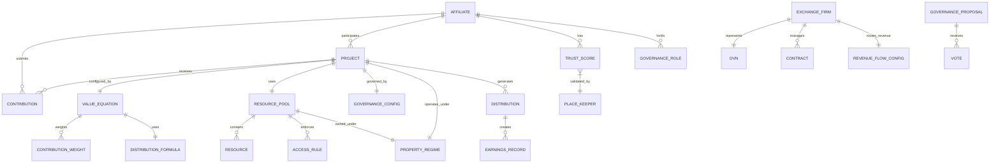

# Sensorica OVN + "Una Nueva Economía" - Integration Design

**Fecha**: 2026-11-12
**Metodología**: HSCSG Unified Assimilation Science - Fase 2/3/4
**Objetivo**: Integrar primitivas Sensorica OVN en ARM packages como módulos anfibios

---

## 1. Análisis Arquitectónico de 5 Capas (estilo Zentrik ARM)

### Capa 1: Domain Model (Types & Entities)

```typescript
// arm-sensorica/src/types.ts - Core Domain Entities

// Primitive: Contribution (tiempo, materiales, capital, knowledge)
interface Contribution {
  id: ContributionId;
  affiliateId: AffiliateId;
  projectId: ProjectId;
  type: ContributionType; // 'time' | 'materials' | 'capital' | 'knowledge' | 'space'
  quantity: Quantity; // horas, unidades, valor monetario, etc.
  timestamp: Timestamp;
  verificationStatus: VerificationStatus; // 'pending' | 'verified' | 'disputed'
  evidence?: EvidenceRef[]; // links to proofs
  metadata: ContributionMetadata;
}

// Primitive: Value Equation Configuration
interface ValueEquationConfig {
  projectId: ProjectId;
  contributionWeights: Map<ContributionType, Weight>; // ej: time=1.0, materials=0.8, capital=1.2
  distributionFormula: DistributionFormula; // 'proportional' | 'logarithmic' | 'hybrid'
  minimumThreshold?: Quantity; // umbral mínimo para participar en distribución
  reservePercentage: Percentage; // % para reserve fund / reinvestment
  exchangeFirmConfig?: ExchangeFirmConfig; // para modo conectado (anfibio)
}

// Primitive: Affiliate (participante en OVN)
interface Affiliate {
  id: AffiliateId;
  profile: AffiliateProfile; // skills, reputation, history
  contributions: ContributionId[];
  earnings: EarningsRecord[]; // historial de distribuciones
  trustScore: TrustScore; // local reputation (place-keeper based)
  governanceRole: GovernanceRole; // 'affiliate' | 'placeKeeper' | 'exchangeFirmRep'
  joinedAt: Timestamp;
}

// Primitive: Project (unidad de producción colaborativa)
interface Project {
  id: ProjectId;
  name: string;
  description: string;
  valueEquation: ValueEquationConfig;
  resourcePool: ResourcePoolId;
  affiliates: AffiliateId[]; // participantes activos
  status: ProjectStatus; // 'forming' | 'active' | 'completed' | 'archived'
  propertyRegime: PropertyRegime; // 'private' | 'commons' | 'non-dominium'
  governance: GovernanceConfig;
  createdAt: Timestamp;
}

// Primitive: Resource Pool (activos mutualizados)
interface ResourcePool {
  id: ResourcePoolId;
  resources: Resource[];
  accessRules: AccessRule[]; // quién puede usar qué, bajo qué condiciones
  propertyRegime: PropertyRegime;
  location?: GeoLocation; // para recursos físicos
  stewardId?: AffiliateId; // place keeper / steward
}

// Primitive: Exchange Firm (interfaz legal vacía)
interface ExchangeFirm {
  id: ExchangeFirmId;
  legalEntity: LegalEntityRef; // referencia a entidad legal real
  representedOVN: OVNId;
  contracts: Contract[]; // contratos con clientes externos
  revenueFlow: RevenueFlowConfig; // cómo fluye ingreso OVN → exchange firm → value equation
  compliance: ComplianceConfig;
}
```

### Capa 2: Operations (Mutations - estilo Zentrik `ops.ts`)

```typescript
// arm-sensorica/src/ops.ts - All Mutations (Single Write Path)

type SensoricaOp =
  | { type: 'contribution.submit'; payload: SubmitContribution }
  | { type: 'contribution.verify'; payload: VerifyContribution }
  | { type: 'project.create'; payload: CreateProject }
  | { type: 'project.join'; payload: JoinProject }
  | { type: 'valueEquation.configure'; payload: ConfigureValueEquation }
  | { type: 'distribution.execute'; payload: ExecuteDistribution }
  | { type: 'resourcePool.add'; payload: AddResource }
  | { type: 'resourcePool.access'; payload: RequestResourceAccess }
  | { type: 'governance.propose'; payload: ProposeGovernanceChange }
  | { type: 'governance.vote'; payload: VoteOnProposal }
  | { type: 'affiliate.register'; payload: RegisterAffiliate }
  | { type: 'trust.update'; payload: UpdateTrustScore }
  | { type: 'exchangeFirm.revenueReceived'; payload: RecordExternalRevenue };

// Invariants (ARM-style):
// 1. One Write Path: All mutations through ops.ts
// 2. Everything Shows Source: Every contribution/decision traces to affiliate
// 3. Nothing Lands Unapproved: Distributions require governance approval
// 4. Your Data Your Rules: Affiliate owns their contribution data
```

### Capa 3: Memory/State (Event Sourcing + Projections)

```typescript
// arm-sensorica/src/memory.ts - Event Store + Projections

interface SensoricaEvent {
  id: EventId;
  type: SensoricaOp['type'];
  payload: SensoricaOp['payload'];
  author: AffiliateId;
  timestamp: Timestamp;
  previousStateHash: Hash; // merkle chain
  signature: Signature; // crypto proof
}

interface SensoricaState {
  // Projections (read models)
  contributions: Map<ContributionId, Contribution>;
  projects: Map<ProjectId, Project>;
  affiliates: Map<AffiliateId, Affiliate>;
  valueEquations: Map<ProjectId, ValueEquationConfig>;
  distributions: Map<DistributionId, DistributionResult>;
  resourcePools: Map<ResourcePoolId, ResourcePool>;
  trustScores: Map<AffiliateId, TrustScore>;
  governanceProposals: Map<ProposalId, Proposal>;
  exchangeFirms: Map<ExchangeFirmId, ExchangeFirm>;
}

// Amphibious projections - dual mode
interface AmphibiousProjection<T> {
  postmonetario: T; // ZNU/CaaS values
  conectado: T;     // USD/USDC via priceParity oracle
  mode: 'postmonetario' | 'conectado';
}
```

### Capa 4: Patterns → Signals (Real-time)

```typescript
// arm-sensorica/src/patterns.ts - Pattern Detection

interface SensoricaPattern {
  id: PatternId;
  name: string;
  description: string;
  detector: (events: SensoricaEvent[]) => PatternMatch[];
}

const SENSORICA_PATTERNS: SensoricaPattern[] = [
  {
    id: 'contribution-streak',
    name: 'Contribution Streak',
    description: 'Affiliate contributing consistently for N periods',
    detector: detectContributionStreak
  },
  {
    id: 'resource-bottleneck',
    name: 'Resource Bottleneck',
    description: 'Resource pool access requests > capacity',
    detector: detectResourceBottleneck
  },
  {
    id: 'value-equation-imbalance',
    name: 'Value Equation Imbalance',
    description: 'Distribution heavily skewed to few contribution types',
    detector: detectValueEquationImbalance
  },
  {
    id: 'governance-stalemate',
    name: 'Governance Stalemate',
    description: 'Proposals not reaching quorum repeatedly',
    detector: detectGovernanceStalemate
  },
  {
    id: 'exchange-firm-drift',
    name: 'Exchange Firm Drift',
    description: 'External revenue not flowing to value equation per config',
    detector: detectExchangeFirmDrift
  },
  {
    id: 'trust-anomaly',
    name: 'Trust Anomaly',
    description: 'Sudden trust score changes without contribution basis',
    detector: detectTrustAnomaly
  }
];
```

### Capa 5: Agent-Human Loop (Review Gates)

```typescript
// arm-sensorica/src/agentHuman.ts - Human-in-the-loop gates

interface ReviewGate {
  id: GateId;
  trigger: OpType; // which ops trigger review
  requiredApprovers: number; // quorum
  approvers: AffiliateId[]; // place keepers / trusted affiliates
  timeout: Duration;
  autoApproveIfTimeout?: boolean;
}

const REVIEW_GATES: ReviewGate[] = [
  {
    id: 'distribution-approval',
    trigger: 'distribution.execute',
    requiredApprovers: 3,
    approvers: [], // filled dynamically from placeKeepers
    timeout: '7d',
    autoApproveIfTimeout: false // distributions need explicit approval
  },
  {
    id: 'value-equation-change',
    trigger: 'valueEquation.configure',
    requiredApprovers: 2,
    approvers: [],
    timeout: '14d',
    autoApproveIfTimeout: false
  },
  {
    id: 'governance-change',
    trigger: 'governance.propose',
    requiredApprovers: 3,
    approvers: [],
    timeout: '30d',
    autoApproveIfTimeout: false
  },
  {
    id: 'exchange-firm-contract',
    trigger: 'exchangeFirm.revenueReceived',
    requiredApprovers: 1,
    approvers: [], // exchange firm rep
    timeout: '3d',
    autoApproveIfTimeout: true // operational
  }
];
```

---

## 2. Data Model Completo (Mermaid)



---

## 3. Anfibio: Value Equation Dual Mode

```typescript
// arm-sensorica/core/valueEquation.ts (extends arm-core/lib/valueDual.ts)

import { MonetaryMode, toDualValue, DualValue, PriceParityOracle } from '@hscsg/arm-core/lib/valueDual';

interface ValueEquationDualConfig extends ValueEquationConfig {
  // Amphibious extensions
  monetaryMode: MonetaryMode; // 'postmonetario' | 'conectado'
  priceOracle?: PriceParityOracle; // required for 'conectado'
  
  // Contribution valuation in dual mode
  contributionValuation: Map<ContributionType, DualValuationRule>;
  
  // Distribution output in dual mode
  distributionOutput: DualDistributionConfig;
}

interface DualValuationRule {
  postmonetario: ValuationFormula; // ZNU/CaaS units
  conectado: ValuationFormula;     // USD/USDC via oracle
}

interface DualDistributionConfig {
  // Output format for each mode
  postmonetario: {
    unit: 'ZNU' | 'CaaS';
    format: (amount: bigint) => string;
  };
  conectado: {
    unit: 'USD' | 'USDC';
    format: (amount: bigint) => string;
    oracle: PriceParityOracle;
  };
}

// Usage in distribution execution:
function executeDistributionDual(
  config: ValueEquationDualConfig,
  contributions: Contribution[],
  revenue: DualValue // { postmonetario: bigint, conectado: bigint }
): DualDistributionResult {
  const mode = config.monetaryMode;
  const valuationRules = config.contributionValuation;
  
  // Calculate contribution scores in active mode
  const scores = contributions.map(c => {
    const rule = valuationRules.get(c.type);
    const formula = mode === 'postmonetario' ? rule.postmonetario : rule.conectado;
    return formula(c.quantity);
  });
  
  // Proportional distribution
  const totalScore = scores.reduce((a, b) => a + b, 0);
  const distributions = scores.map((score, i) => {
    const share = (score * revenue[mode]) / totalScore;
    return { affiliateId: contributions[i].affiliateId, amount: share };
  });
  
  return {
    mode,
    distributions,
    totalDistributed: revenue[mode],
    timestamp: now(),
    auditTrail: generateAuditTrail(contributions, scores, distributions)
  };
}
```

---

## 4. Access Control & Property Regimes (desde Exploration phase)

```typescript
// arm-sensorica/core/accessControl.ts

type PropertyRegime = 
  | { type: 'private'; owner: LegalEntityId }
  | { type: 'public'; authority: GovernmentId }
  | { type: 'commons'; stewards: AffiliateId[]; rules: CommonsRules }
  | { type: 'non-dominium'; trust: TrustId; community: AffiliateId[] };

interface AccessControlConfig {
  propertyRegime: PropertyRegime;
  authentication: AuthMethod; // PKI, biometric, smartphone, etc.
  authorization: AuthzModel;  // RBAC, ABAC, capability-based
  trustModel: TrustModel;     // local (place-keeper) | federated | p2p-reputation
  privacyLevel: PrivacyLevel; // what gets recorded publicly
  interoperability: InteropConfig; // standards for cross-regime access
}

interface PlaceKeeper {
  affiliateId: AffiliateId;
  spaceId: SpaceId; // physical or virtual
  permissions: Permission[]; // grant/deny access, update trust
  accountability: AccountabilityConfig; // audit trail of decisions
}

// Trust emanates locally (Tiberius principle)
function calculateLocalTrust(
  placeKeeper: PlaceKeeper,
  subject: AffiliateId,
  context: AccessContext
): TrustScore {
  // Direct observation by place keeper
  const directObs = placeKeeper.observations.get(subject) ?? 0;
  
  // Peer reports from same space
  const peerReports = getPeerReports(placeKeeper.spaceId, subject);
  
  // Historical access compliance
  const compliance = getAccessCompliance(placeKeeper.spaceId, subject);
  
  // Weighted combination (local knowledge priority)
  return weightedScore({
    directObservation: 0.5,
    peerReports: 0.3,
    historicalCompliance: 0.2
  }, { directObs, peerReports, compliance });
}
```

---

## 5. Blockchain Primitives (desde Exploration phase - sin tokens)

```typescript
// arm-sensorica/core/blockchainPrimitives.ts

// Solo primitives criptográficas, NO tokens/especulación

interface CryptoPrimitives {
  hash: HashFunction;           // SHA-256, BLAKE3
  hashPointer: HashPointer;     // Merkle DAG for event chain
  digitalSignature: Signature;  // Ed25519, secp256k1
  publicKeyIdentity: PublicKey; // PKI for affiliate identity
  consensus: ConsensusProtocol; // para governance decisions
  bft: ByzantineFaultTolerance; // threshold signatures
}

// Uso: Event chain integrity (NO blockchain público)
function createEventChain(events: SensoricaEvent[]): MerkleDAG {
  return events.reduce((dag, event) => {
    const hash = hashEvent(event);
    const pointer = createHashPointer(dag.tip, hash);
    return dag.append({ event, hash, pointer });
  }, emptyDAG);
}

// Uso: Governance voting with BFT
function executeGovernanceVote(
  proposal: Proposal,
  votes: Vote[],
  threshold: ThresholdConfig
): VoteResult {
  const validVotes = votes.filter(v => verifySignature(v));
  const weight = calculateVoteWeight(validVotes);
  return weight.meetsThreshold(threshold) ? 'passed' : 'failed';
}
```

---

## 6. Integración con Paquetes ARM Existentes

### 5.1 `arm-core` - Extensiones

```typescript
// arm-core/lib/valueDual.ts - ADD amphbious value equation
export interface ValueEquationDualConfig extends ValueEquationConfig { ... }
export function executeDistributionDual(...) { ... }

// arm-core/lib/brand.ts - ADD Sensorica patterns to brand registry
export const SENSORICA_PATTERNS = { ... } // pattern definitions

// arm-core/src/types.ts - ADD Sensorica types
export type { Contribution, Affiliate, Project, ValueEquationConfig, ... }
```

### 5.2 `arm-gratiferia` - Extensión Affiliate Model

```typescript
// arm-gratiferia/src/core/affiliate.ts (NEW)

import { Affiliate, Contribution, TrustScore } from '@hscsg/arm-sensorica';

// Gratifieria-specific affiliate extensions
interface GratifieriaAffiliate extends Affiliate {
  karma: Karma; // from arm-gratiferia core
  swapPreferences: SwapPreferences; // for matchmaker
  valueDualConfig: ValueEquationDualConfig; // personal value equation
}

// Integration: Gratifieria listings can be Sensorica projects
function createGratifieriaProjectFromListing(
  listing: Listing,
  creator: GratifieriaAffiliate
): Project {
  return {
    id: generateProjectId(),
    name: listing.title,
    description: listing.description,
    valueEquation: creator.valueDualConfig,
    resourcePool: creator.resourcePoolId,
    affiliates: [creator.id],
    propertyRegime: { type: 'commons', stewards: [creator.id], rules: defaultCommonsRules },
    governance: defaultGovernanceConfig,
    createdAt: now()
  };
}
```

### 5.3 `arm-cli` - Comandos Sensorica

```bash
# arm-sensorica CLI commands (via arm-cli)
arm sensorica contribution submit --project <id> --type time --quantity 10h
arm sensorica contribution verify --contribution <id> --approve
arm sensorica project create --name "Open Hardware Lab" --regime commons
arm sensorica distribution execute --project <id> --mode postmonetario
arm sensorica governance propose --type valueEquation --config <file>
arm sensorica trust update --affiliate <id> --score 0.85 --reason "consistent quality"
arm sensorica resource add --pool <id> --type "3d-printer" --location "lab-1"
```

### 5.4 `arm-mcp` - MCP Tools Sensorica

```typescript
// arm-sensorica/mcp/src/index.ts - MCP Tools

const SENSORICA_MCP_TOOLS = [
  'submit_contribution',
  'verify_contribution', 
  'create_project',
  'execute_distribution',
  'configure_value_equation',
  'propose_governance',
  'vote_proposal',
  'register_affiliate',
  'update_trust',
  'add_resource',
  'request_resource_access',
  'record_external_revenue'
];
```

---

## 7. OpenSpec SDD Spec para arm-sensorica

```yaml
# arm-sensorica/openspec/specs/arm-sensorica.openspec.yml
specVersion: "1.0"
package: "@hscsg/arm-sensorica"
version: "0.1.0"
description: "Sensorica OVN primitives for ARM - Open Value Network patterns"

domain:
  entities:
    - Contribution
    - Affiliate
    - Project
    - ValueEquation
    - ResourcePool
    - ExchangeFirm
    - PropertyRegime
    - TrustScore
    - GovernanceProposal

operations:
  - contribution.submit
  - contribution.verify
  - project.create
  - project.join
  - valueEquation.configure
  - distribution.execute
  - resourcePool.add
  - resourcePool.access
  - governance.propose
  - governance.vote
  - affiliate.register
  - trust.update
  - exchangeFirm.revenueReceived

invariants:
  - SEN-001: "Every contribution traces to authenticated affiliate"
  - SEN-002: "Distribution amounts sum to revenue input"
  - SEN-003: "Value equation weights non-negative"
  - SEN-004: "Governance proposals require quorum"
  - SEN-005: "Trust scores updated only by place keepers"
  - SEN-006: "Exchange firm revenue flows per config"
  - SEN-007: "Property regime determines access rules"

traces:
  SEN-001: ["contribution.submit", "contribution.verify"]
  SEN-002: ["distribution.execute"]
  SEN-003: ["valueEquation.configure"]
  SEN-004: ["governance.propose", "governance.vote"]
  SEN-005: ["trust.update"]
  SEN-006: ["exchangeFirm.revenueReceived"]
  SEN-007: ["project.create", "resourcePool.add"]
```

---

## 8. Tests Unitarios Requeridos

```typescript
// arm-sensorica/tests/valueEquation.test.ts

describe('ValueEquation Dual Mode', () => {
  test('distribution proportional in postmonetario mode', () => {
    const config = createTestConfig({ mode: 'postmonetario' });
    const contributions = [
      { affiliateId: 'a1', type: 'time', quantity: 10 },
      { affiliateId: 'a2', type: 'materials', quantity: 5 }
    ];
    const revenue = { postmonetario: 1000n, conectado: 500n };
    
    const result = executeDistributionDual(config, contributions, revenue);
    
    expect(result.mode).toBe('postmonetario');
    expect(result.distributions[0].amount).toBeGreaterThan(result.distributions[1].amount);
  });

  test('distribution uses price oracle in conectado mode', () => {
    const config = createTestConfig({ 
      mode: 'conectado',
      priceOracle: mockOracle
    });
    // ... test USD distribution with oracle
  });

  test('amphibious switch maintains proportions', () => {
    // Same contributions, different modes → proportional results
  });
});

describe('Trust Local (Place Keeper)', () => {
  test('trust calculated from direct observation priority', () => {
    const pk = createPlaceKeeper({ observations: { 'aff1': 0.9 } });
    const trust = calculateLocalTrust(pk, 'aff1', context);
    expect(trust).toBeGreaterThan(0.8);
  });
});

describe('Access Control by Property Regime', () => {
  test('commons regime requires steward approval', () => {
    const regime = { type: 'commons', stewards: ['pk1'], rules: {...} };
    const access = requestAccess(regime, 'aff1', 'resource1');
    expect(access.requiredApprovals).toContain('pk1');
  });
});
```

---

## 9. Archivos a Crear (Fase 3 Implementation)

| Archivo | Descripción |
|---------|-------------|
| `packages/arm-sensorica/package.json` | Package config con deps `@hscsg/arm-core`, `@hscsg/arm-gratiferia` |
| `packages/arm-sensorica/tsconfig.build.json` | TypeScript config |
| `packages/arm-sensorica/src/types.ts` | Domain entities (ver sección 1) |
| `packages/arm-sensorica/src/ops.ts` | Mutations (ver sección 2) |
| `packages/arm-sensorica/src/memory.ts` | Event store + projections (ver sección 3) |
| `packages/arm-sensorica/src/patterns.ts` | Pattern detectors (ver sección 4) |
| `packages/arm-sensorica/src/agentHuman.ts` | Review gates (ver sección 5) |
| `packages/arm-sensorica/src/core/valueEquation.ts` | Dual-mode distribution |
| `packages/arm-sensorica/src/core/contributionAccounting.ts` | Contribution tracking |
| `packages/arm-sensorica/src/core/governance.ts` | OVN governance |
| `packages/arm-sensorica/src/core/resourcePool.ts` | Resource mutualization |
| `packages/arm-sensorica/src/core/accessControl.ts` | Property regimes + auth |
| `packages/arm-sensorica/src/core/trustLocal.ts` | Place-keeper trust |
| `packages/arm-sensorica/src/core/exchangeFirm.ts` | Legal interface pattern |
| `packages/arm-sensorica/src/core/blockchainPrimitives.ts` | Crypto primitives only |
| `packages/arm-sensorica/src/core/affiliate.ts` | Affiliate management |
| `packages/arm-sensorica/src/cli/index.ts` | CLI commands |
| `packages/arm-sensorica/src/mcp/index.ts` | MCP tools |
| `packages/arm-sensorica/tests/valueEquation.test.ts` | Unit tests |
| `packages/arm-sensorica/tests/accessControl.test.ts` | Unit tests |
| `packages/arm-sensorica/tests/governance.test.ts` | Unit tests |
| `packages/arm-sensorica/openspec/specs/arm-sensorica.openspec.yml` | OpenSpec SDD |

---

## 10. Actualización Root Package.json

```json
// package.json (root) - ADD workspace
{
  "workspaces": [
    "packages/arm-core",
    "packages/arm-cli", 
    "packages/arm-mcp",
    "packages/arm-api",
    "packages/arm-ui",
    "packages/arm-gratiferia",
    "packages/arm-sensorica"  // NEW
  ],
  "scripts": {
    "sensorica:build": "npm run build --workspace=packages/arm-sensorica",
    "sensorica:test": "npm run test --workspace=packages/arm-sensorica",
    "sensorica:typecheck": "npm run typecheck --workspace=packages/arm-sensorica"
  }
}
```

---

## 11. Próximos Pasos (Fase 4 Validation)

1. **Crear package arm-sensorica** con estructura arriba
2. **Implementar core types + ops + memory** (siguiendo patterns arm-core)
3. **Implementar valueEquation.ts** con dual mode (extender valueDual.ts)
4. **Implementar accessControl + trustLocal + governance** 
5. **Tests unitarios** (≥ 30 tests covering all primitives)
6. **Build + typecheck** → fix errors
7. **E2E validation** → contribution → project → distribution flow
8. **Integrar con arm-gratiferia** → affiliate model + matchmaker
9. **Documentar en** `docs/asimilacion/sensorica-ovn/integration.md` (este archivo)

---

## 12. Referencias a Skill HSCSG

```markdown
# skills/hscsg-unified-assimilation-science/references/sensorica-ovn-assimilation.md
- Patrones OVN extraídos
- Value Equation dual mode
- Property regimes & access control
- Trust local (place keeper)
- Exchange firm pattern
- Blockchain primitives (no tokens)
```